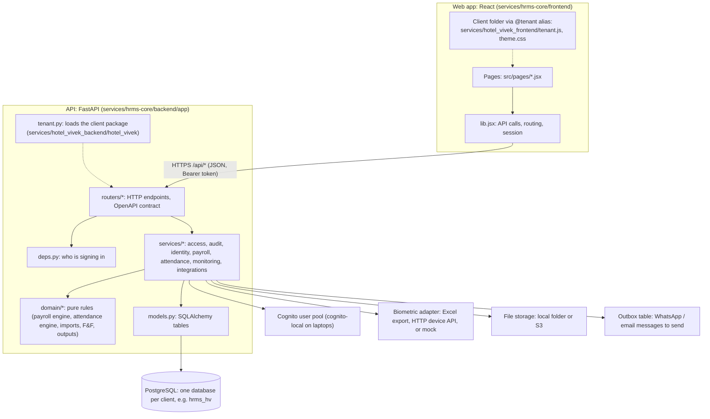

# Application layers

| Layer | Folder | May do | Must not do |
|---|---|---|---|
| Pages | `frontend/src/pages` | Show data, call the API, hide menu items the role lacks | Decide access (the API does), hold business rules |
| Client folder (web) | `services/<client>_frontend` | Names, texts, languages, theme | Change screens or behaviour |
| Routers | `backend/app/routers` | Validate input, check permission, call services, return JSON | Calculate pay or attendance directly |
| Services | `backend/app/services` | Database work, access rules, audit, external systems | Hard-code a client's data |
| Domain | `backend/app/domain` | Pure calculations with no database (fully unit-tested) | Read the database or the clock directly |
| Models + migrations | `backend/app/models.py`, `alembic/versions` | Define tables; every change gets a migration | Edit an old migration |
| Client package (API) | `services/<client>_backend/<package>` | Client code and name, demo data for laptops, KRA templates, import examples | Contain real client data |

Every change written by a service also writes a row to `audit_log` (append-only, enforced by a database trigger).
