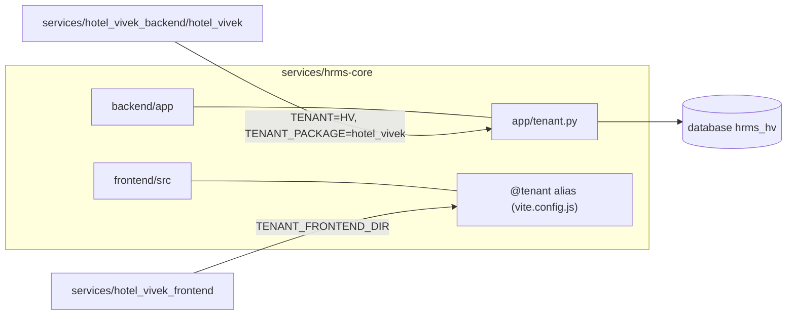

# Folder structure and clients (tenants)

Decision record: [0006](../decisions/0006-folder-structure-and-clients.md) · Jira: SCRUM-128

```
services/
  hrms-core/
    backend/                 FastAPI app, migrations, core tests      (common to every client)
    frontend/                React app, nginx config                  (common to every client)
  hotel_vivek_backend/       Hotel Vivek only (tenant code HV)
    hotel_vivek/tenant.py      code, name, demo users, synthetic organisation and staff, KRA templates, import examples
    tests/                     Hotel Vivek end-to-end API tests
    samples/                   synthetic Excel files for import testing
    Dockerfile                 API image = hrms-core backend + hotel_vivek package
  hotel_vivek_frontend/      Hotel Vivek only
    tenant.js, theme.css       names, texts, languages (Tamil, English, Hindi), theme
    Dockerfile                 web image = hrms-core frontend built with this folder
docs/
  architecture/              application layers and flows (this folder)
  features/                  one document per feature
  decisions/                 decision records
```

## How a client is plugged in



A new client gets two new folders (`<client>_backend`, `<client>_frontend`) copied from the Hotel Vivek ones, its own tenant code, its own database and its own sign-in user pool. hrms-core is not copied or changed for a client.

## Rules

| Rule | How it is enforced |
|---|---|
| Tenant code for Hotel Vivek is **HV** | `TENANT=HV`; the client package must declare `CODE = "HV"` or the API will not start |
| **One database per client** | Database name `hrms_<code>` (`hrms_hv`); on first start the database is stamped with the code (`app_settings.tenant_code`) and the API refuses to start against another client's database |
| **Synthetic data only on laptops** | Demo data loads only when `ENVIRONMENT` is `local`, `dev` or `test`; `SEED_DEMO` is ignored in QA and production. All demo names, codes and numbers are made up |
| **Real client data only in QA and production** | Loaded there through Company setup and the Excel imports; never copied to laptops. Laptop sign-in users end in `@hotelvivek.local` |
| No Peak Brain or chatbot inside HRMS | CI fails if `Peak Brain` or `chatbot` appears in the services code. An "Ask Brain" link is planned after the demo (SCRUM-131) |
