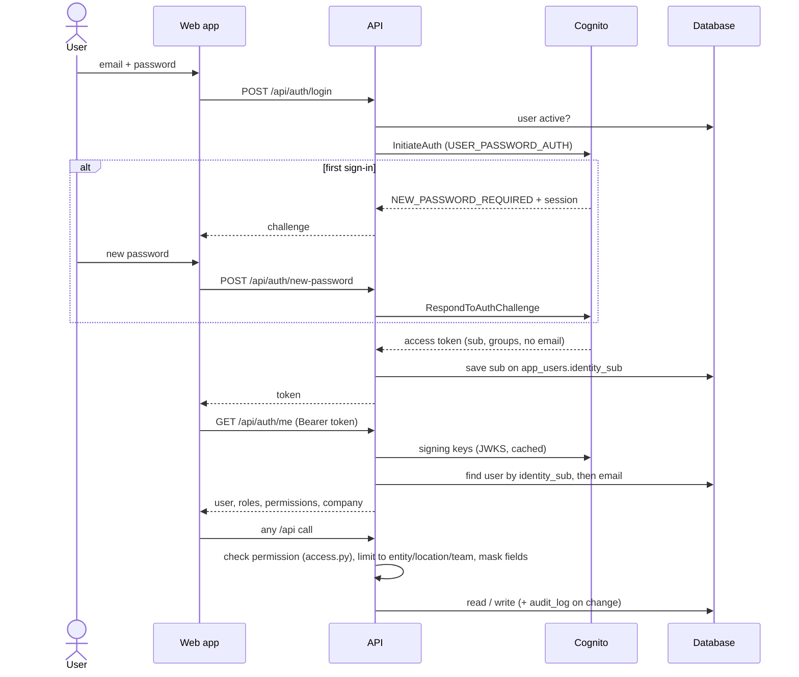

# Request and sign-in flow

- On laptops without Docker, `AUTH_MODE=local` replaces Cognito with app-held passwords; the flow is the same for the user.
- The menu hides what a role cannot do, but the API is where access is decided.
