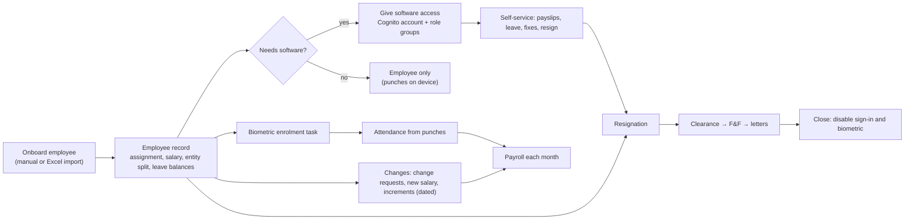

# Employee lifecycle flow

| Stage | Tables | Feature doc |
|---|---|---|
| Onboard | employees, assignments, entity_allocations, salary_structures, leave_balances, provisioning_tasks | [08](../features/08-onboarding.md), [11](../features/11-excel-imports.md) |
| Access | app_users, provisioning_tasks | [03](../features/03-users-and-provisioning.md) |
| Changes | change_requests, salary_structures, entity_allocations, increments | [10](../features/10-change-requests.md), [12](../features/12-salary-and-split.md), [24](../features/24-increments.md) |
| Exit | exit_cases, clearance_tasks | [21](../features/21-exits-and-fnf.md) |
