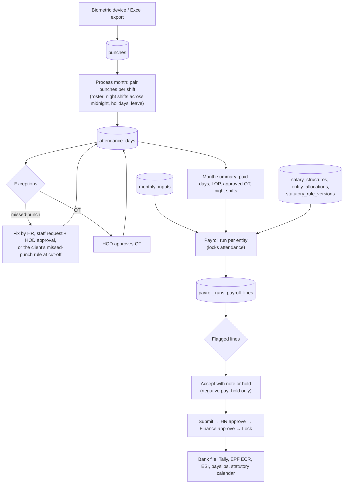

# Attendance to payroll flow

- Payroll is blocked while missed punches are open and the missed-punch rule is not set (no default).
- Payroll work is on hold until the client's salary sheets arrive; the flow above is built and tested with synthetic data.
