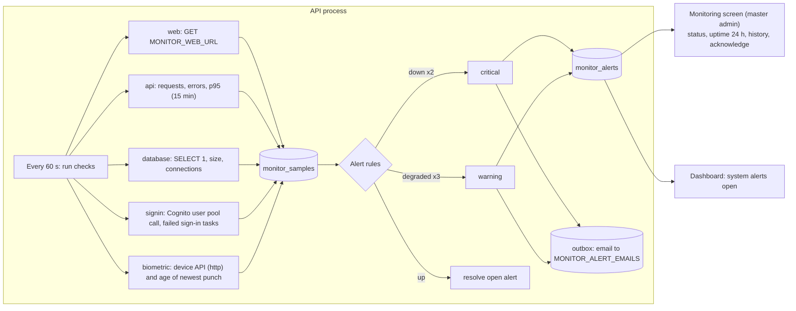

# Monitoring flow (SCRUM-130)

| Service | Up | Degraded | Down |
|---|---|---|---|
| Web app | HTTP 200 under 1.5 s | slower | not reachable / not 200 |
| API | normal | >5% server errors (≥20 requests) or p95 > 2 s | — (cannot report itself; container health check and infrastructure monitoring cover it) |
| Database | SELECT 1 under 500 ms | slower | error |
| Sign-in | user pool answers | failed sign-in provisioning tasks | Cognito not reachable |
| Biometric | punches newer than 26 h | no new punches for 26 h, or none yet | device API not reachable (http adapter) |

Settings: `MONITOR_INTERVAL_SECONDS` (60), `MONITOR_WEB_URL`, `MONITOR_BIOMETRIC_STALE_HOURS` (26), `MONITOR_ALERT_EMAILS`, `MONITOR_KEEP_DAYS` (7).
