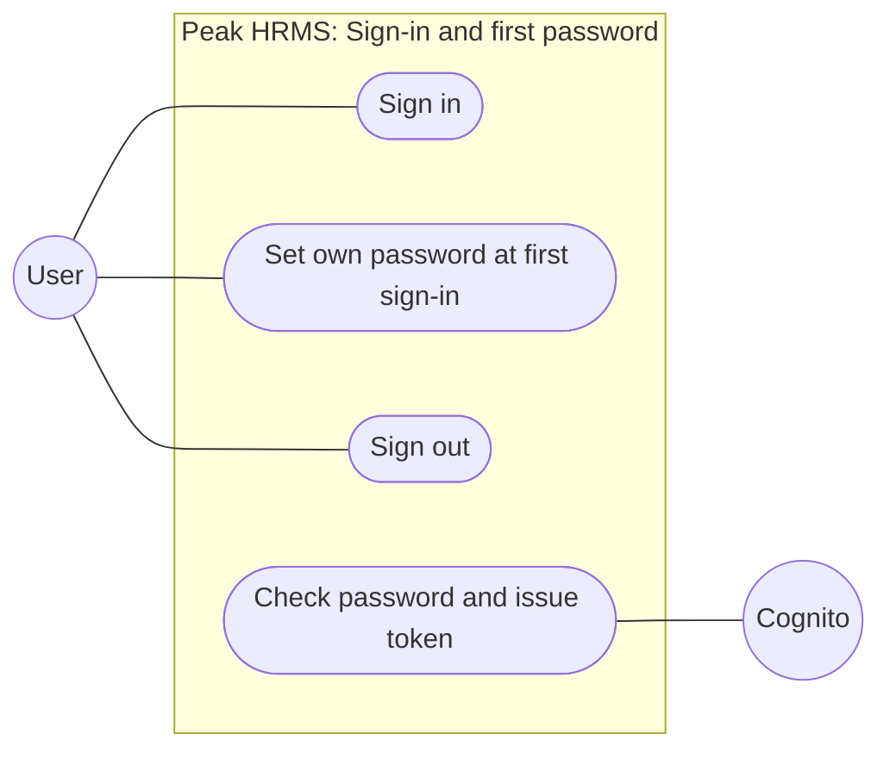
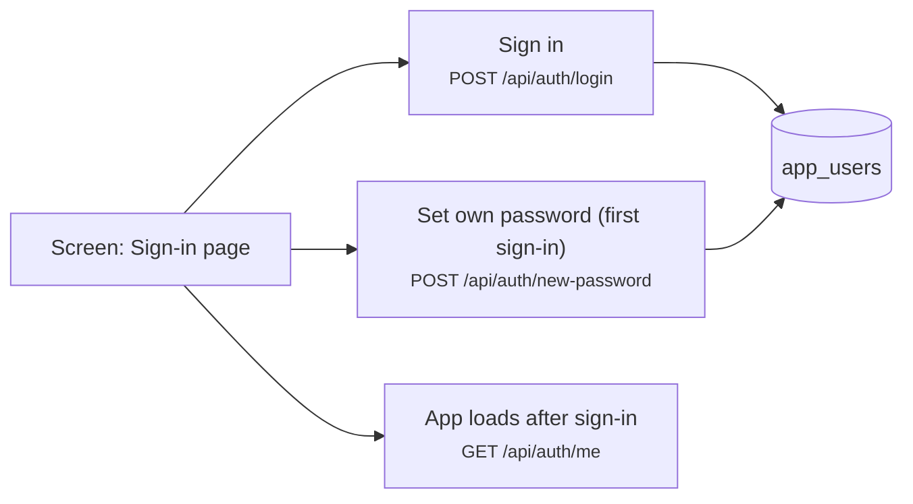

# Sign-in and first password

**Jira:** SCRUM-116, SCRUM-39 (part), SCRUM-46  
**Status:** built (synthetic data on laptops). Items marked "not built" below are open.

## What it does

People sign in with email and password. Accounts live in Cognito (cognito-local on laptops, the client's user pool in QA/production). A new user signs in with a temporary password and must set their own (Cognito NEW_PASSWORD_REQUIRED). The API checks the token on every request and maps it to the HRMS user by Cognito `sub`.

## Who uses it

| Role | Uses it to |
|---|---|
| Everyone with a user account | Signs in, sets own password, signs out |

## Screens

- Sign-in page (`/login`)

## Use cases

## Data flow (screen → API → tables)

| Screen action | API | Reads | Writes |
|---|---|---|---|
| Sign in | `POST /api/auth/login` | app_users | app_users.identity_sub (first sign-in) |
| Set own password (first sign-in) | `POST /api/auth/new-password` | app_users | app_users.identity_sub |
| App loads after sign-in | `GET /api/auth/me` | app_users, employees | — |

Diagram of the writes (every change also adds a row to `audit_log`, left out of the diagram for clarity):

## Rules and limits

- `AUTH_MODE=cognito` (Docker, QA, production) or `local` (quick native runs and tests only).
- Cognito access tokens carry no email; the user is found by `identity_sub`, then by email (bug fixed 16-Nov: every request after sign-in returned 401).
- Inactive users cannot sign in (`app_users.is_active`).
- Single sign-on and phone OTP (SCRUM-39) are not built; the sign-in method for the Brain link is decided by the infrastructure owner (SCRUM-131).

## Code and tests

- `services/hrms-core/backend/app/services/identity.py`
- `services/hrms-core/backend/app/deps.py`
- `services/hrms-core/frontend/src/pages/Login.jsx`
- Test: `tests/test_api_hv.py::test_health_and_login (Hotel Vivek)`
- Test: `tests/test_monitoring.py (local sign-in)`
