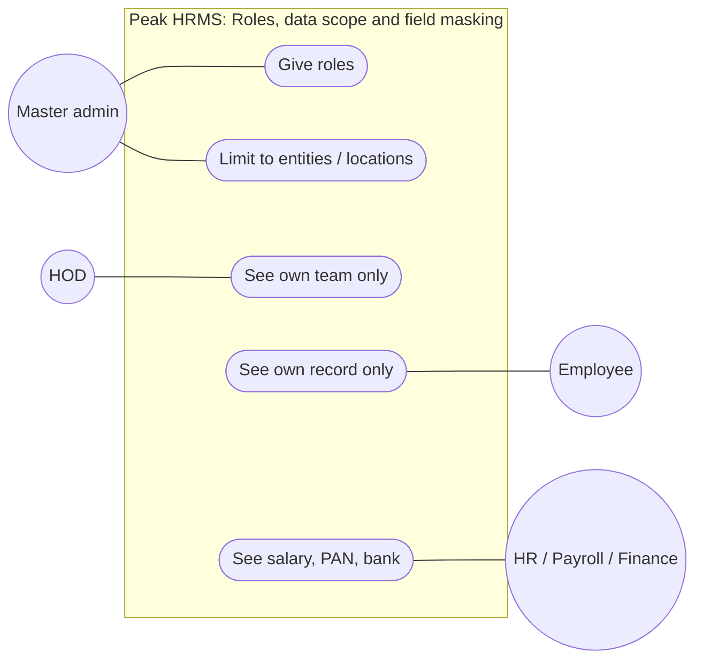
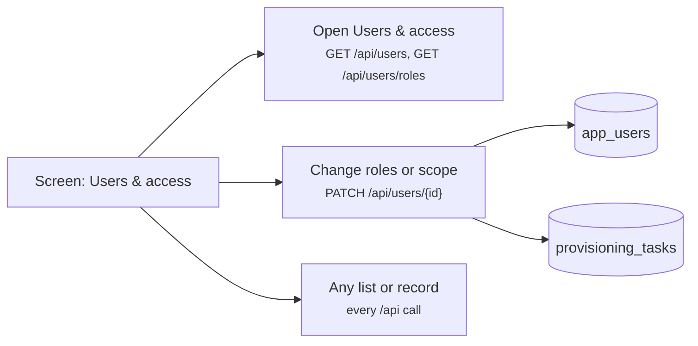

# Roles, data scope and field masking

**Jira:** SCRUM-46, SCRUM-116  
**Status:** built (synthetic data on laptops). Items marked "not built" below are open.

## What it does

Six roles decide what a user can do; entity and location scope decide whose records they see; salary, PAN, Aadhaar and bank are masked for roles that must not see them. Every rule is enforced in the API, not only by hiding menu items.

## Who uses it

| Role | Uses it to |
|---|---|
| Master admin | Gives roles and scope |
| All users | See only what their role and scope allow |

## Screens

- Users & access (`/users`) → Edit
- Menu (items hidden when the role lacks the permission)

## Use cases

## Data flow (screen → API → tables)

| Screen action | API | Reads | Writes |
|---|---|---|---|
| Open Users & access | `GET /api/users, GET /api/users/roles` | app_users | — |
| Change roles or scope | `PATCH /api/users/{id}` | app_users | app_users, provisioning_tasks (Cognito groups), audit_log |
| Any list or record | `every /api call` | app_users (roles, entity_scope, location_scope) | — |

Diagram of the writes (every change also adds a row to `audit_log`, left out of the diagram for clarity):

## Rules and limits

- Roles: master admin, HR, payroll preparer, finance approver, HOD, employee (`services/access.py`).
- HOD sees self + team (manager_id); employee sees self only.
- PAN and bank are encrypted at rest; only the last 4 Aadhaar digits are stored.
- The preparer of a payroll cannot approve it; finance approval must be a third person.

## Code and tests

- `services/hrms-core/backend/app/services/access.py`
- `services/hrms-core/backend/app/serial.py`
- Test: `test_api_hv.py::test_scope_and_masking`
- Test: `test_api_hv.py::test_preparer_cannot_approve`
