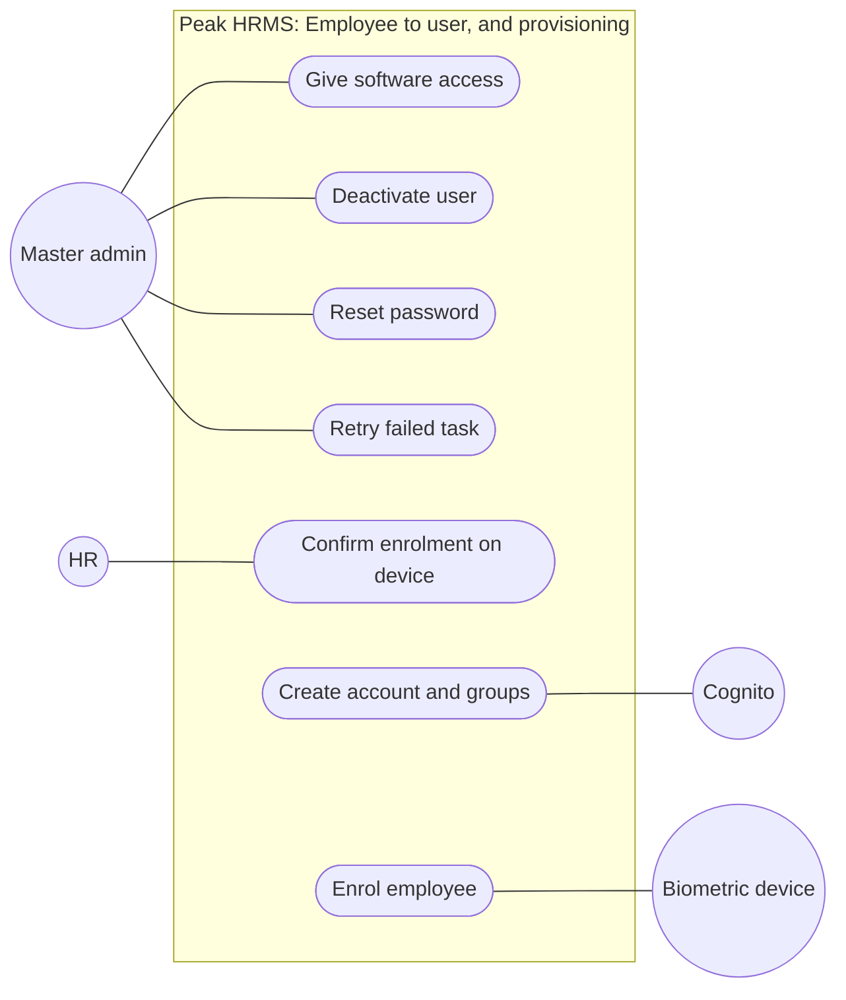
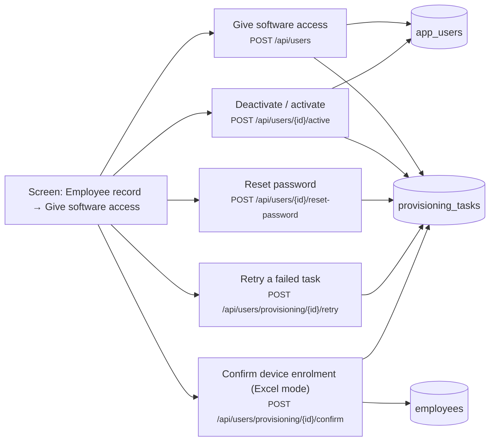

# Employee to user, and provisioning

**Jira:** SCRUM-116, SCRUM-46, SCRUM-120 (part)  
**Status:** built (synthetic data on laptops). Items marked "not built" below are open.

## What it does

An employee is a record; a user is someone who can sign in. Giving software access creates the Cognito account with role groups. Every employee also gets a biometric enrolment task. Each target has its own status (pending, done, failed, manual), attempt count, last error and a Retry button. On exit, both are disabled.

## Who uses it

| Role | Uses it to |
|---|---|
| Master admin | Creates users, deactivates, resets passwords, retries failed tasks |
| HR | Confirms manual biometric enrolment |

## Screens

- Employee record → Give software access
- Users & access → Users
- Users & access → Provisioning

## Use cases

## Data flow (screen → API → tables)

| Screen action | API | Reads | Writes |
|---|---|---|---|
| Give software access | `POST /api/users` | employees | app_users, provisioning_tasks, audit_log |
| Deactivate / activate | `POST /api/users/{id}/active` | app_users | app_users, provisioning_tasks, audit_log |
| Reset password | `POST /api/users/{id}/reset-password` | app_users | provisioning_tasks, audit_log |
| Retry a failed task | `POST /api/users/provisioning/{id}/retry` | provisioning_tasks | provisioning_tasks, app_users / employees.biometric_id |
| Confirm device enrolment (Excel mode) | `POST /api/users/provisioning/{id}/confirm` | provisioning_tasks | provisioning_tasks, employees.biometric_id |

Diagram of the writes (every change also adds a row to `audit_log`, left out of the diagram for clarity):

## Rules and limits

- A failure in one target never blocks the other.
- Temporary passwords are shown once and never stored in plain text.
- Excel biometric mode makes enrolment a manual task.

## Code and tests

- `services/hrms-core/backend/app/routers/users.py`
- `services/hrms-core/backend/app/services/provisioning.py`
- `services/hrms-core/frontend/src/pages/Users.jsx`
- Test: `test_api_hv.py::test_onboard_and_convert_to_user`
