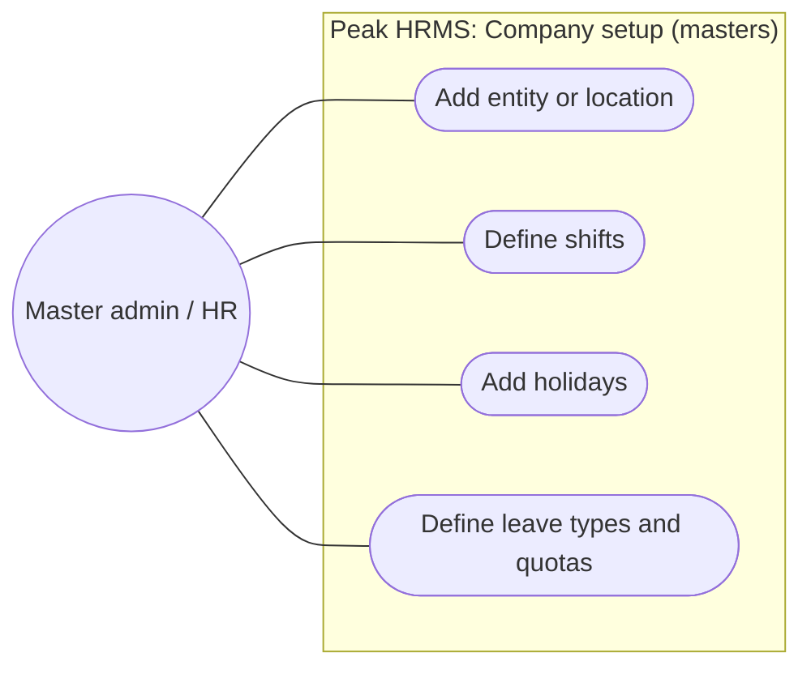
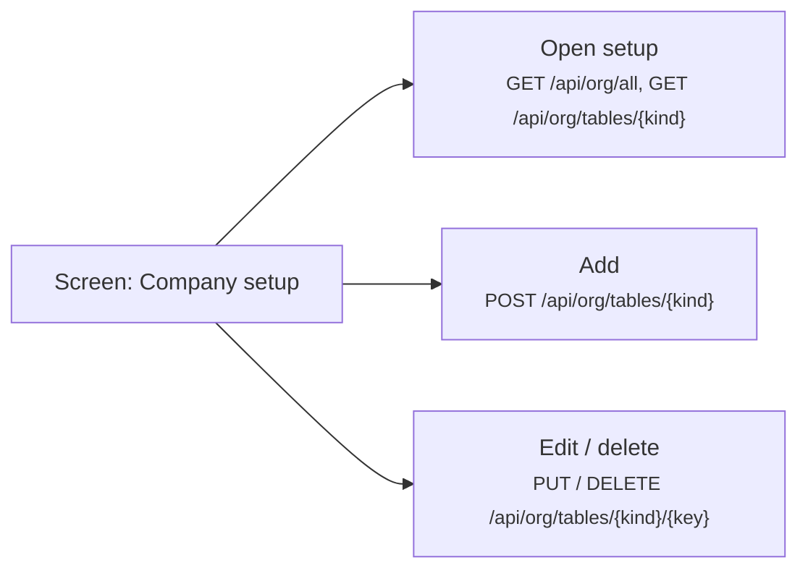

# Company setup (masters)

**Jira:** SCRUM-40  
**Status:** built (synthetic data on laptops). Items marked "not built" below are open.

## What it does

Entities (paying companies), locations, departments, designations, grades, shifts, holidays and leave types. Entities, locations and departments are set inactive instead of deleted so history stays intact.

## Who uses it

| Role | Uses it to |
|---|---|
| Master admin, HR | Maintain the masters |

## Screens

- Company setup (`/settings`) → Entities, Locations, Departments, Designations, Grades, Shifts, Holidays, Leave types

## Use cases

## Data flow (screen → API → tables)

| Screen action | API | Reads | Writes |
|---|---|---|---|
| Open setup | `GET /api/org/all, GET /api/org/tables/{kind}` | entities, locations, departments, designations, grades, shifts, holidays, leave_types | — |
| Add | `POST /api/org/tables/{kind}` | — | the master table, audit_log |
| Edit / delete | `PUT / DELETE /api/org/tables/{kind}/{key}` | the master table | the master table, audit_log |

Diagram of the writes (every change also adds a row to `audit_log`, left out of the diagram for clarity):

## Rules and limits

- One client per deployment and database (decision 0006); entities inside it are the client's companies.
- Night shifts (end before start) are allowed.

## Code and tests

- `services/hrms-core/backend/app/routers/org.py`
- `services/hrms-core/frontend/src/pages/Settings.jsx`
- Test: `Covered by the seeded data in test_api_hv.py`
