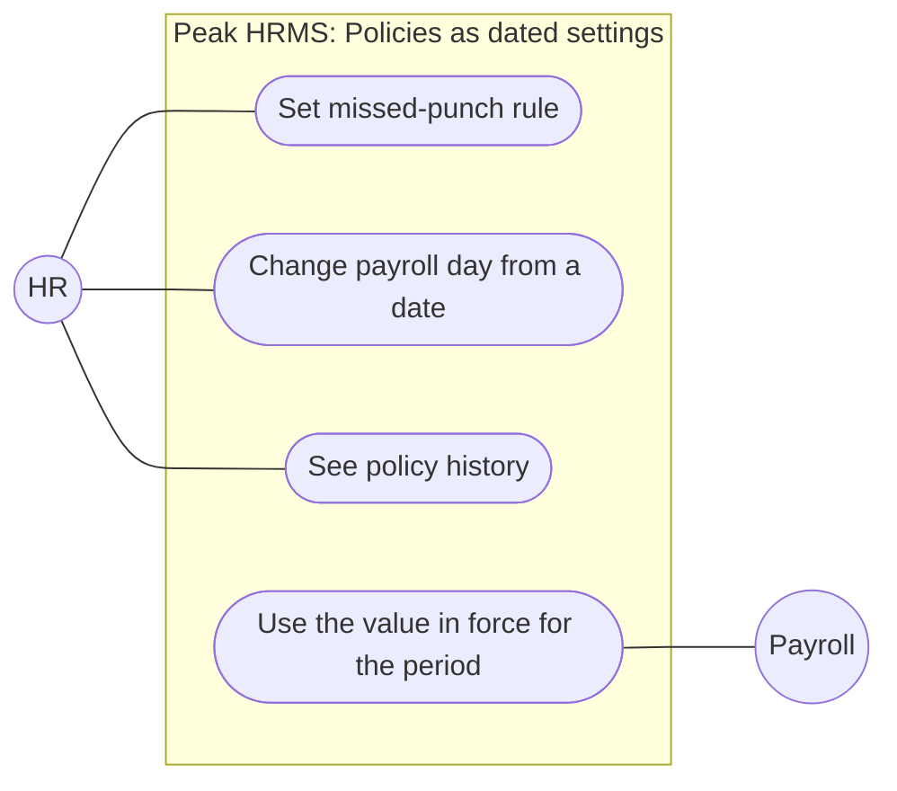
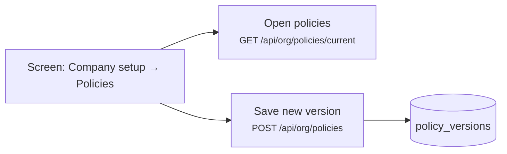

# Policies as dated settings

**Jira:** SCRUM-41, SCRUM-56, SCRUM-122  
**Status:** built (synthetic data on laptops). Items marked "not built" below are open.

## What it does

Payroll day, attendance cut-off, missed-punch rule, grace minutes, OT thresholds, leave escalation, notice and F&F days are stored as versions with an effective-from date. Earlier periods keep the value that was in force. The missed-punch rule has no default: payroll is blocked while missed punches are open until the client sets it.

## Who uses it

| Role | Uses it to |
|---|---|
| Master admin, HR | Set a new value from a date |

## Screens

- Company setup → Policies

## Use cases

## Data flow (screen → API → tables)

| Screen action | API | Reads | Writes |
|---|---|---|---|
| Open policies | `GET /api/org/policies/current` | policy_versions | — |
| Save new version | `POST /api/org/policies` | — | policy_versions, audit_log |

Diagram of the writes (every change also adds a row to `audit_log`, left out of the diagram for clarity):

## Rules and limits

- Values are never overwritten; a new version closes nothing and applies from its date.
- Open business decisions are listed in docs/open-decisions.md.

## Code and tests

- `services/hrms-core/backend/app/services/policies.py`
- `services/hrms-core/backend/app/routers/org.py`
- Test: `test_attendance_imports_fnf.py (missed-punch gate)`
- Test: `test_api_hv.py::test_attendance_and_payroll_flow`
