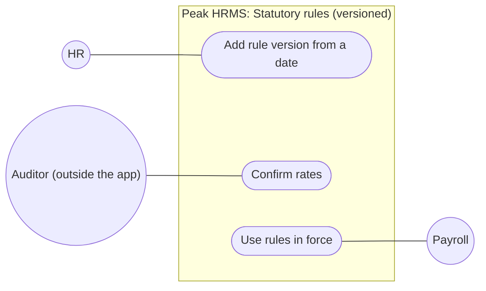
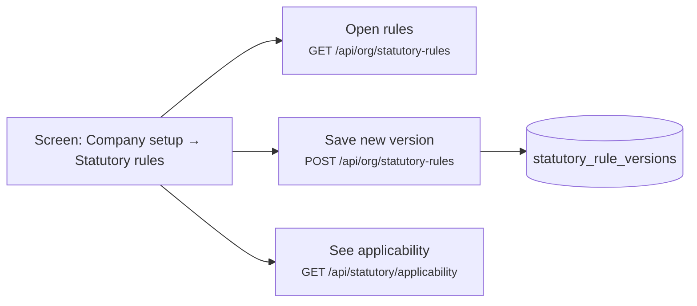

# Statutory rules (versioned)

**Jira:** SCRUM-34, SCRUM-119  
**Status:** built (synthetic data on laptops). Items marked "not built" below are open.

## What it does

PF, ESI, PT, LWF, TDS and OT rates and slabs are one JSON rule set with an effective-from date, optionally per entity. A locked payroll keeps a snapshot of the rules it used. The shipped values are samples until the client's auditor confirms them.

## Who uses it

| Role | Uses it to |
|---|---|
| Master admin, HR | Add a new rule version |
| Payroll preparer, Finance | See which rules apply |

## Screens

- Company setup → Statutory rules
- Statutory → Registrations by entity

## Use cases

## Data flow (screen → API → tables)

| Screen action | API | Reads | Writes |
|---|---|---|---|
| Open rules | `GET /api/org/statutory-rules` | statutory_rule_versions | — |
| Save new version | `POST /api/org/statutory-rules` | — | statutory_rule_versions, audit_log |
| See applicability | `GET /api/statutory/applicability` | entities | — |

Diagram of the writes (every change also adds a row to `audit_log`, left out of the diagram for clarity):

## Rules and limits

- Payroll is on hold until the client's salary sheets arrive; rules are not changed meanwhile.
- Rules are code-checked by unit tests in test_payroll_engine.py.

## Code and tests

- `services/hrms-core/backend/app/domain/payroll_engine.py`
- `services/hrms-core/backend/app/routers/org.py`
- Test: `test_payroll_engine.py`
