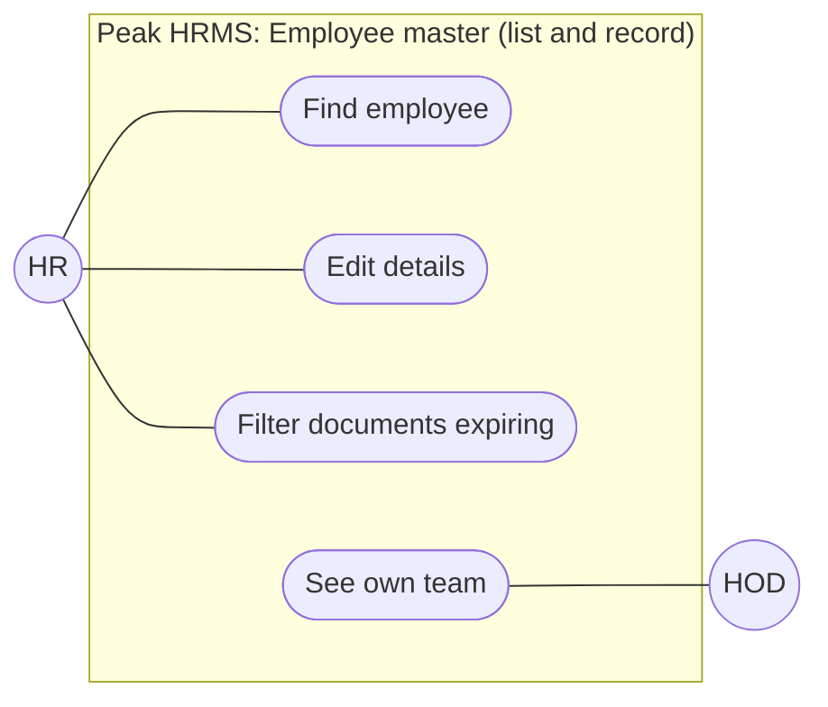
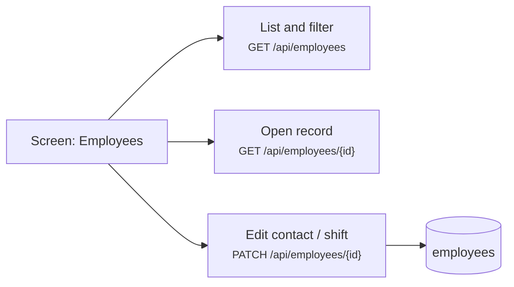

# Employee master (list and record)

**Jira:** SCRUM-44  
**Status:** built (synthetic data on laptops). Items marked "not built" below are open.

## What it does

Searchable, filterable list of all staff (entity, location, department, status, documents expiring) and a record with tabs: profile, pay, documents, change requests and timeline. Sensitive fields follow the masking rules.

## Who uses it

| Role | Uses it to |
|---|---|
| HR, Master admin | Maintain records |
| Payroll, Finance, HOD | Read (HOD: own team only) |

## Screens

- Employees (`/employees`)
- Employee record (`/employees/:id`)

## Use cases

## Data flow (screen → API → tables)

| Screen action | API | Reads | Writes |
|---|---|---|---|
| List and filter | `GET /api/employees` | employees, employee_documents, change_requests, app_users | — |
| Open record | `GET /api/employees/{id}` | employees, assignments, salary_structures, entity_allocations, employee_documents, change_requests, app_users | — |
| Edit contact / shift | `PATCH /api/employees/{id}` | employees | employees, audit_log |

Diagram of the writes (every change also adds a row to `audit_log`, left out of the diagram for clarity):

## Rules and limits

- Location, department, designation and grade changes are dated (assignments).
- Bank and PAN changes from staff go through change requests.

## Code and tests

- `services/hrms-core/backend/app/routers/employees.py`
- `services/hrms-core/frontend/src/pages/Employees.jsx`
- Test: `test_api_hv.py::test_scope_and_masking`
