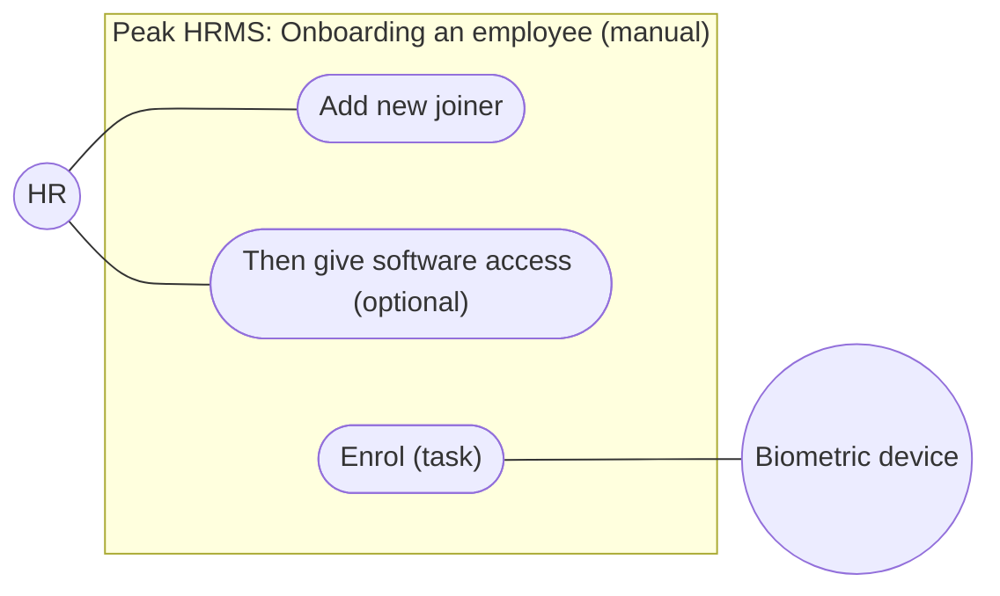
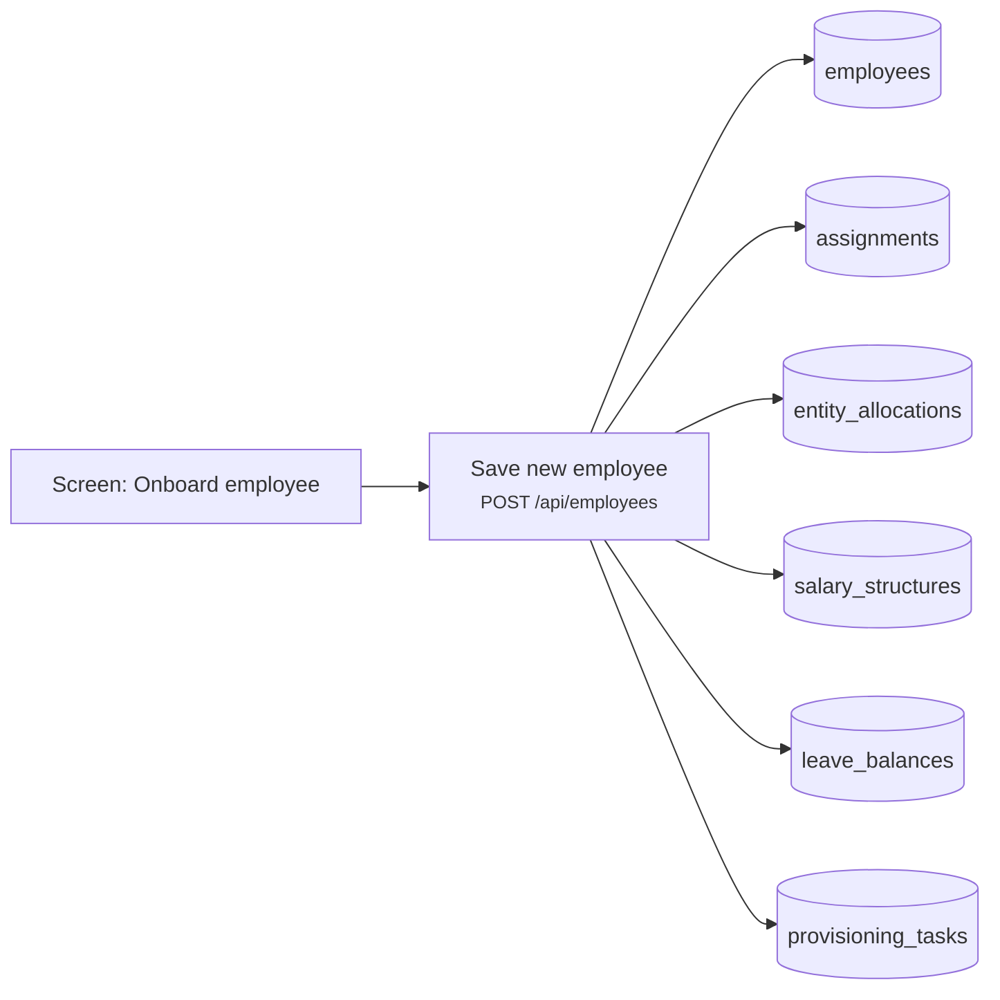

# Onboarding an employee (manual)

**Jira:** SCRUM-79 (part), SCRUM-121  
**Status:** built (synthetic data on laptops). Items marked "not built" below are open.

## What it does

HR adds a new joiner by hand: person, job, statutory and bank details and monthly gross. The system creates the first assignment, 100% allocation to the location's entity, a salary structure (Basic 50%, HRA 20%, Conveyance 1,600, rest Special), leave balances and a biometric enrolment task. No agent, no offer-letter automation (removed with Peak Brain). Software access is a separate step.

## Who uses it

| Role | Uses it to |
|---|---|
| HR, Master admin | Onboard |

## Screens

- Onboard employee (`/employees/new`)

## Use cases

## Data flow (screen → API → tables)

| Screen action | API | Reads | Writes |
|---|---|---|---|
| Save new employee | `POST /api/employees` | entities, locations, grades, leave_types | employees, assignments, entity_allocations, salary_structures, leave_balances, provisioning_tasks, audit_log |

Diagram of the writes (every change also adds a row to `audit_log`, left out of the diagram for clarity):

## Rules and limits

- Mandatory: code, name, joining date, location, department, PAN, bank account, IFSC (same as import).
- Day-1 checklist (SCRUM-79) is not built.

## Code and tests

- `services/hrms-core/backend/app/services/employees.py`
- `services/hrms-core/frontend/src/pages/Employees.jsx (EmployeeNew)`
- Test: `test_api_hv.py::test_onboard_and_convert_to_user`
