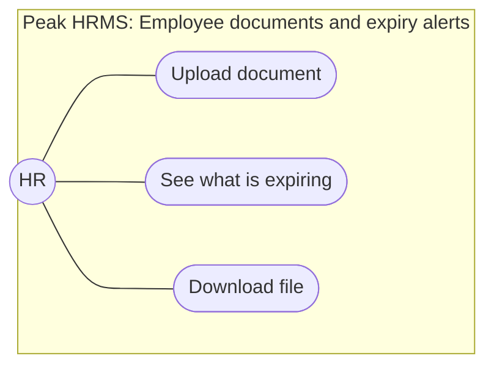
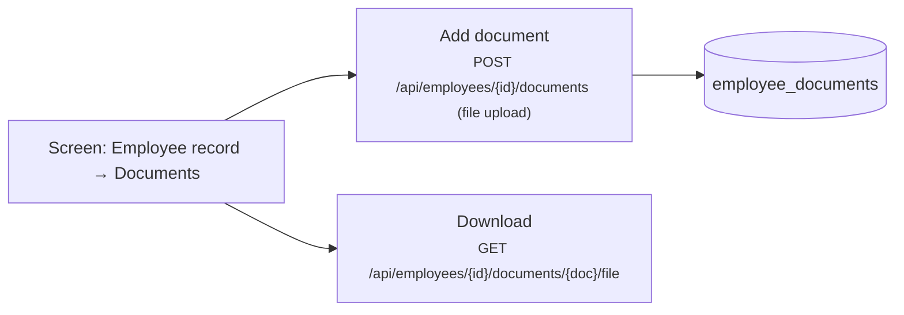

# Employee documents and expiry alerts

**Jira:** SCRUM-44  
**Status:** built (synthetic data on laptops). Items marked "not built" below are open.

## What it does

Documents (e.g. police verification, food handler certificate) with number (stored masked), expiry date and file. Documents expiring within the policy window are flagged on the list and the dashboard.

## Who uses it

| Role | Uses it to |
|---|---|
| HR | Add and download documents |

## Screens

- Employee record → Documents
- Employees → filter 'Documents expiring'
- Dashboard

## Use cases

## Data flow (screen → API → tables)

| Screen action | API | Reads | Writes |
|---|---|---|---|
| Add document | `POST /api/employees/{id}/documents (file upload)` | employees | employee_documents, file storage, audit_log |
| Download | `GET /api/employees/{id}/documents/{doc}/file` | employee_documents, file storage | — |

Diagram of the writes (every change also adds a row to `audit_log`, left out of the diagram for clarity):

## Rules and limits

- Files go to the local storage folder on laptops or S3 in QA/production (STORAGE_DIR / S3_BUCKET).
- Expiry window = policy doc_expiry_days (30).

## Code and tests

- `services/hrms-core/backend/app/routers/employees.py`
- `services/hrms-core/backend/app/services/integrations.py`
- Test: none yet
