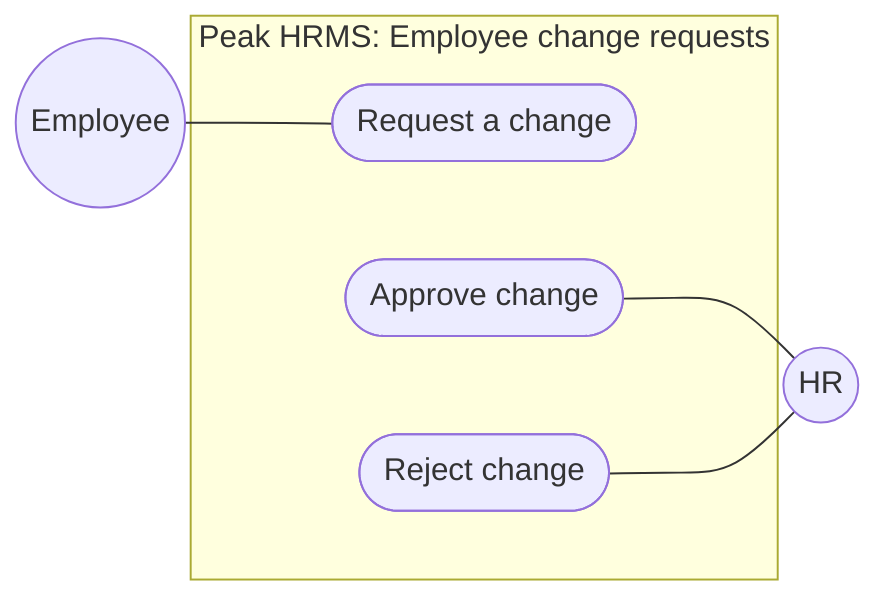
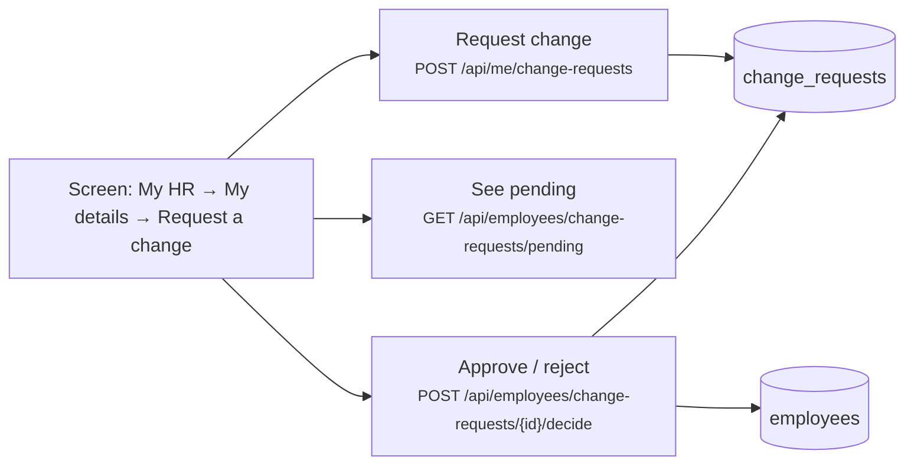

# Employee change requests

**Jira:** SCRUM-45  
**Status:** built (synthetic data on laptops). Items marked "not built" below are open.

## What it does

Staff ask for a change to their own details (phone, address, bank, PAN...). HR approves or rejects; approved values are written to the record.

## Who uses it

| Role | Uses it to |
|---|---|
| Employee | Requests |
| HR | Approves or rejects |

## Screens

- My HR → My details → Request a change
- Employee record → Change requests
- Approvals

## Use cases

## Data flow (screen → API → tables)

| Screen action | API | Reads | Writes |
|---|---|---|---|
| Request change | `POST /api/me/change-requests` | employees | change_requests, audit_log |
| See pending | `GET /api/employees/change-requests/pending` | change_requests | — |
| Approve / reject | `POST /api/employees/change-requests/{id}/decide` | change_requests | change_requests, employees, audit_log |

Diagram of the writes (every change also adds a row to `audit_log`, left out of the diagram for clarity):

## Rules and limits

- New values for PAN and bank are encrypted like the record.

## Code and tests

- `services/hrms-core/backend/app/routers/employees.py`
- `services/hrms-core/backend/app/routers/people.py (/me)`
- Test: none yet
