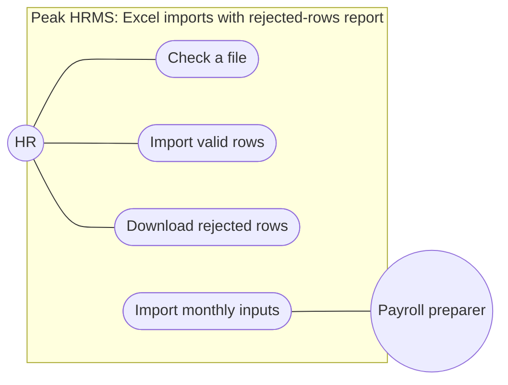
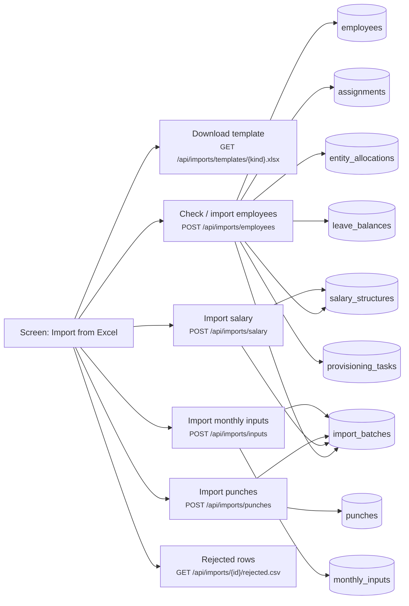

# Excel imports with rejected-rows report

**Jira:** SCRUM-42 (part), SCRUM-43, SCRUM-101, SCRUM-118, SCRUM-125  
**Status:** built (synthetic data on laptops). Items marked "not built" below are open.

## What it does

Four imports: employee master, salary structures, biometric punches and monthly pay inputs. Check first (nothing saved), then import valid rows. Every row is either imported or rejected with its reasons, so imported + rejected = rows in the file. Templates download with example rows from the client package.

## Who uses it

| Role | Uses it to |
|---|---|
| HR, Master admin | Employees, salary, punches |
| Payroll preparer | Monthly inputs |

## Screens

- Import from Excel (`/imports`)

## Use cases

## Data flow (screen → API → tables)

| Screen action | API | Reads | Writes |
|---|---|---|---|
| Download template | `GET /api/imports/templates/{kind}.xlsx` | — (examples from the client package) | — |
| Check / import employees | `POST /api/imports/employees` | entities, locations, departments, designations, grades, employees | import_batches, employees, assignments, entity_allocations, salary_structures, leave_balances, provisioning_tasks, audit_log |
| Import salary | `POST /api/imports/salary` | employees | import_batches, salary_structures, audit_log |
| Import punches | `POST /api/imports/punches` | employees | import_batches, punches |
| Import monthly inputs | `POST /api/imports/inputs` | employees | import_batches, monthly_inputs |
| Rejected rows | `GET /api/imports/{id}/rejected.csv` | import_batches | — |

Diagram of the writes (every change also adds a row to `audit_log`, left out of the diagram for clarity):

## Rules and limits

- Column names are matched by aliases (Emp Code / Employee Code...).
- Google Sheets import and a column-mapping screen (SCRUM-42) are not built.
- Hotel Vivek sample files (synthetic): services/hotel_vivek_backend/samples.

## Code and tests

- `services/hrms-core/backend/app/domain/imports.py`
- `services/hrms-core/backend/app/routers/imports.py`
- Test: `test_attendance_imports_fnf.py`
- Test: `test_api_hv.py::test_import_with_planted_errors`
