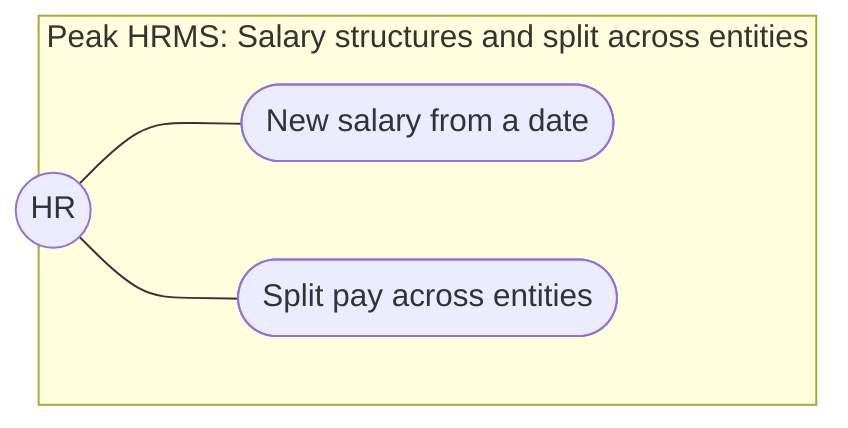
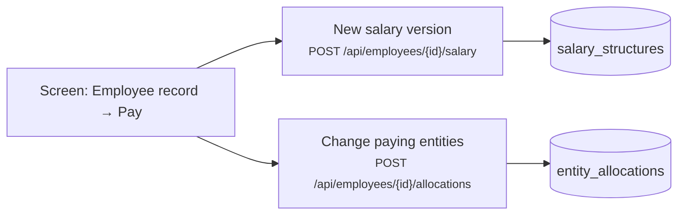

# Salary structures and split across entities

**Jira:** SCRUM-43, SCRUM-117, SCRUM-71  
**Status:** built (synthetic data on laptops). Items marked "not built" below are open.

## What it does

Dated salary structures (components per month) and dated allocations that split an employee's pay across paying entities by percent or fixed amount. Each entity's payroll pays its share.

## Who uses it

| Role | Uses it to |
|---|---|
| HR | Change salary or split |
| Payroll, Finance | Read |

## Screens

- Employee record → Pay

## Use cases

## Data flow (screen → API → tables)

| Screen action | API | Reads | Writes |
|---|---|---|---|
| New salary version | `POST /api/employees/{id}/salary` | salary_structures | salary_structures (old one closed the day before), audit_log |
| Change paying entities | `POST /api/employees/{id}/allocations` | entity_allocations | entity_allocations, audit_log |

Diagram of the writes (every change also adds a row to `audit_log`, left out of the diagram for clarity):

## Rules and limits

- Statutory basis per rule set: combined (proportional) or per entity (decision 0005).
- Exactly one primary entity per allocation set.

## Code and tests

- `services/hrms-core/backend/app/services/employees.py`
- `services/hrms-core/backend/app/domain/payroll_engine.py (split_amount)`
- Test: `test_payroll_engine.py (split cases)`
