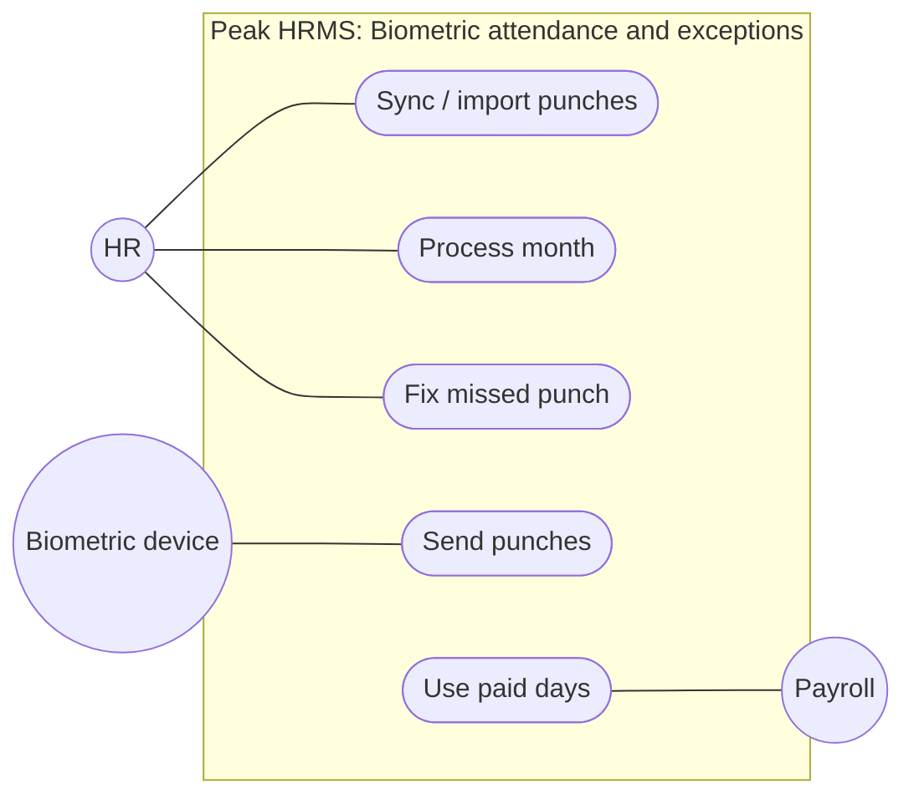
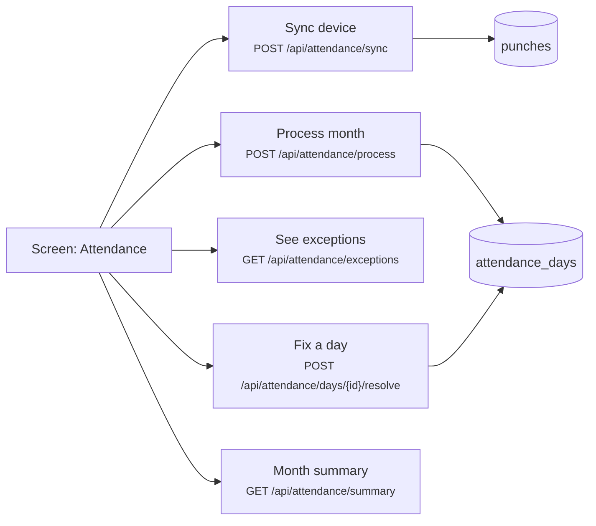

# Biometric attendance and exceptions

**Jira:** SCRUM-50 (part), SCRUM-52, SCRUM-56, SCRUM-57, SCRUM-120 (part), SCRUM-127  
**Status:** built (synthetic data on laptops). Items marked "not built" below are open.

## What it does

Punches arrive from the device adapter (Excel export today; HTTP adapter ready for the vendor API) and are paired into days per shift. Night shifts across midnight count on the start date. Days are flagged present, late, missed punch, absent, leave, holiday or weekly off, with OT minutes. Missed punches are fixed by hand or by the client's missed-punch rule at cut-off.

## Who uses it

| Role | Uses it to |
|---|---|
| HR, Payroll preparer | Sync, process, fix exceptions |
| HOD | Read own team |

## Screens

- Attendance (`/attendance`) → Exceptions, Daily register, Month summary

## Use cases

## Data flow (screen → API → tables)

| Screen action | API | Reads | Writes |
|---|---|---|---|
| Sync device | `POST /api/attendance/sync` | employees | punches |
| Process month | `POST /api/attendance/process` | punches, roster, shifts, holidays, leave_requests, employees | attendance_days |
| See exceptions | `GET /api/attendance/exceptions` | attendance_days, policy_versions | — |
| Fix a day | `POST /api/attendance/days/{id}/resolve` | attendance_days | attendance_days, audit_log |
| Month summary | `GET /api/attendance/summary` | attendance_days, policy_versions | — |

Diagram of the writes (every change also adds a row to `audit_log`, left out of the diagram for clarity):

## Rules and limits

- Attendance runs on synthetic data until the machine model and its API/export are known (SCRUM-120).
- Locked days (payroll) and regularised days are not reprocessed.

## Code and tests

- `services/hrms-core/backend/app/domain/attendance_engine.py`
- `services/hrms-core/backend/app/services/attendance.py`
- `services/hrms-core/backend/app/routers/attendance.py`
- Test: `test_attendance_imports_fnf.py`
