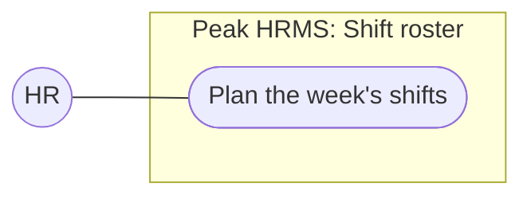
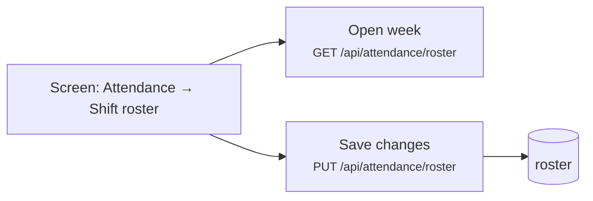

# Shift roster

**Jira:** SCRUM-51 (part)  
**Status:** built (synthetic data on laptops). Items marked "not built" below are open.

## What it does

Weekly grid of employees × days where the shift for each day is chosen; processing uses the roster before the employee's default shift.

## Who uses it

| Role | Uses it to |
|---|---|
| HR, Payroll preparer | Plan shifts |
| HOD | Read |

## Screens

- Attendance → Shift roster

## Use cases

## Data flow (screen → API → tables)

| Screen action | API | Reads | Writes |
|---|---|---|---|
| Open week | `GET /api/attendance/roster` | employees, roster, shifts | — |
| Save changes | `PUT /api/attendance/roster` | — | roster |

Diagram of the writes (every change also adds a row to `audit_log`, left out of the diagram for clarity):

## Rules and limits

- Split shifts (two blocks in one day) are not built (SCRUM-51).

## Code and tests

- `services/hrms-core/backend/app/routers/attendance.py`
- Test: none yet
