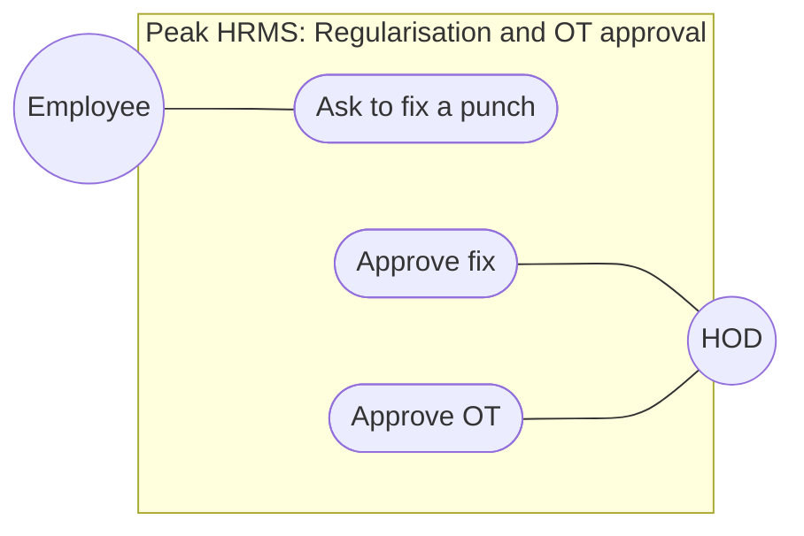
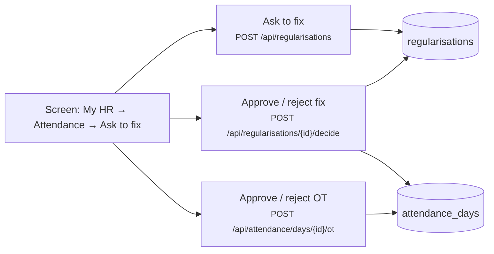

# Regularisation and OT approval

**Jira:** SCRUM-54  
**Status:** built (synthetic data on laptops). Items marked "not built" below are open.

## What it does

Staff ask to fix a missed punch with times and a reason; the HOD approves. Overtime counts for pay only after HOD/HR approval.

## Who uses it

| Role | Uses it to |
|---|---|
| Employee | Asks to fix a punch |
| HOD, HR | Approve fixes and OT |

## Screens

- My HR → Attendance → Ask to fix
- Attendance → Exceptions → OT to approve
- Approvals

## Use cases

## Data flow (screen → API → tables)

| Screen action | API | Reads | Writes |
|---|---|---|---|
| Ask to fix | `POST /api/regularisations` | attendance_days | regularisations |
| Approve / reject fix | `POST /api/regularisations/{id}/decide` | regularisations | regularisations, attendance_days, audit_log |
| Approve / reject OT | `POST /api/attendance/days/{id}/ot` | attendance_days | attendance_days, audit_log |

Diagram of the writes (every change also adds a row to `audit_log`, left out of the diagram for clarity):

## Rules and limits

- OT below the threshold is ignored; OT is counted in 30-minute blocks.

## Code and tests

- `services/hrms-core/backend/app/routers/attendance.py`
- Test: `test_api_hv.py::test_attendance_and_payroll_flow`
