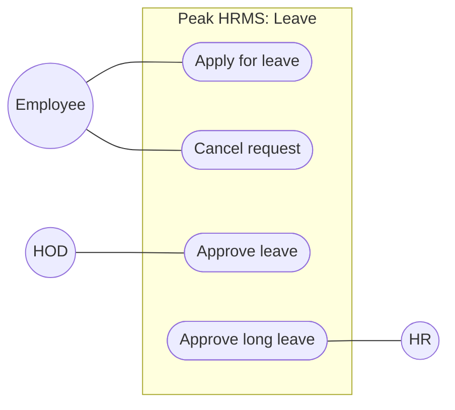
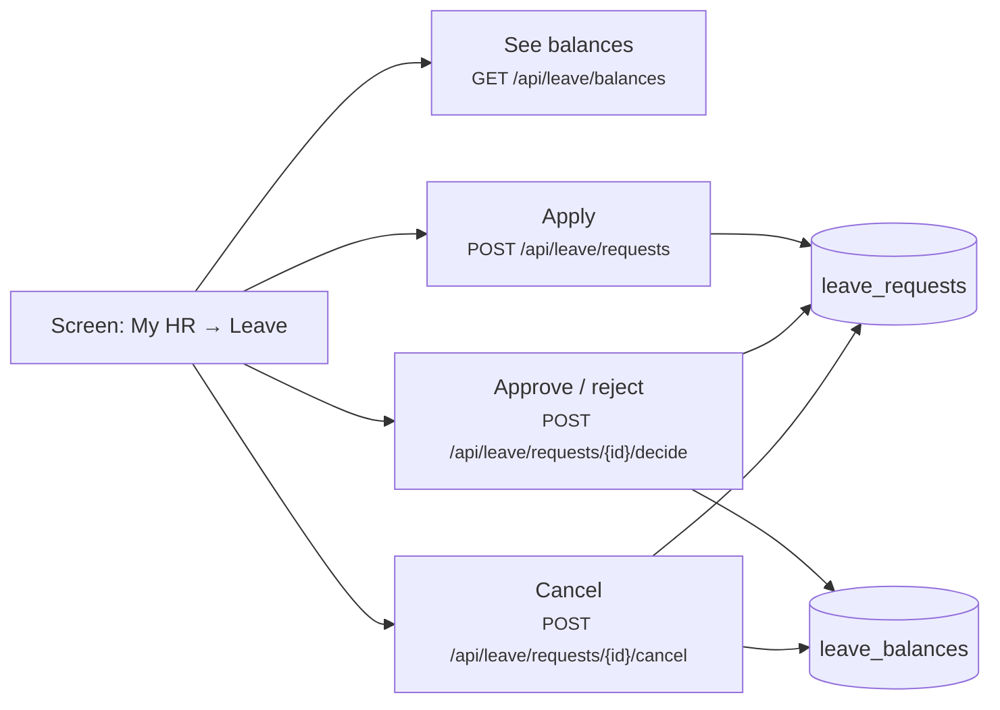

# Leave

**Jira:** SCRUM-55  
**Status:** built (synthetic data on laptops). Items marked "not built" below are open.

## What it does

Leave balances per type and year, requests from staff, approval by the HOD and, for long leave, then by HR. Approved leave shows in attendance.

## Who uses it

| Role | Uses it to |
|---|---|
| Employee | Applies, cancels |
| HOD, HR | Approve |

## Screens

- My HR → Leave
- Leave (`/leave`)
- Approvals

## Use cases

## Data flow (screen → API → tables)

| Screen action | API | Reads | Writes |
|---|---|---|---|
| See balances | `GET /api/leave/balances` | leave_balances, leave_types | — |
| Apply | `POST /api/leave/requests` | leave_balances, holidays | leave_requests |
| Approve / reject | `POST /api/leave/requests/{id}/decide` | leave_requests | leave_requests, leave_balances, audit_log |
| Cancel | `POST /api/leave/requests/{id}/cancel` | leave_requests | leave_requests, leave_balances |

Diagram of the writes (every change also adds a row to `audit_log`, left out of the diagram for clarity):

## Rules and limits

- Leave over policy leave_hr_after_days goes to HR after the HOD.

## Code and tests

- `services/hrms-core/backend/app/routers/attendance.py`
- Test: `test_api_hv.py::test_leave_flow_hod`
