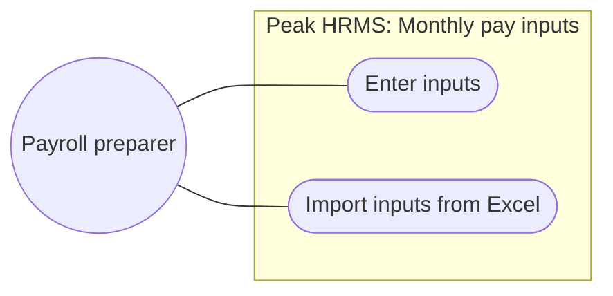
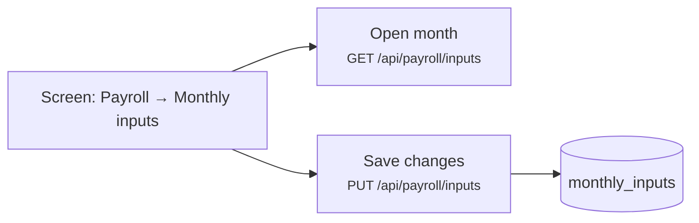

# Monthly pay inputs

**Jira:** SCRUM-59  
**Status:** built (synthetic data on laptops). Items marked "not built" below are open.

## What it does

Grid of one-off amounts per employee per month: service charge, incentive, arrears, bonus, other earnings, advances, loan EMI, other deductions and TDS override. Locked once the period's payroll is locked.

## Who uses it

| Role | Uses it to |
|---|---|
| Payroll preparer | Enters or imports inputs |

## Screens

- Payroll → Monthly inputs
- Import from Excel → Monthly pay inputs

## Use cases

## Data flow (screen → API → tables)

| Screen action | API | Reads | Writes |
|---|---|---|---|
| Open month | `GET /api/payroll/inputs` | employees, monthly_inputs, payroll_runs | — |
| Save changes | `PUT /api/payroll/inputs` | — | monthly_inputs, audit_log |

Diagram of the writes (every change also adds a row to `audit_log`, left out of the diagram for clarity):

## Rules and limits

- Payroll is on hold until the client's salary sheets arrive.

## Code and tests

- `services/hrms-core/backend/app/routers/payroll.py`
- Test: `test_api_hv.py::test_attendance_and_payroll_flow`
