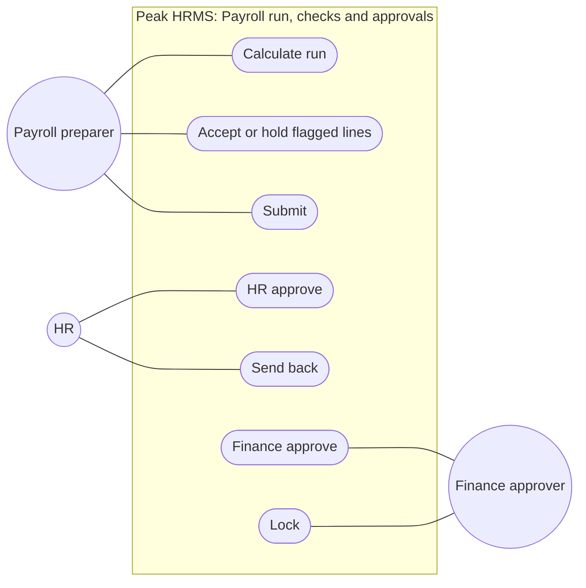
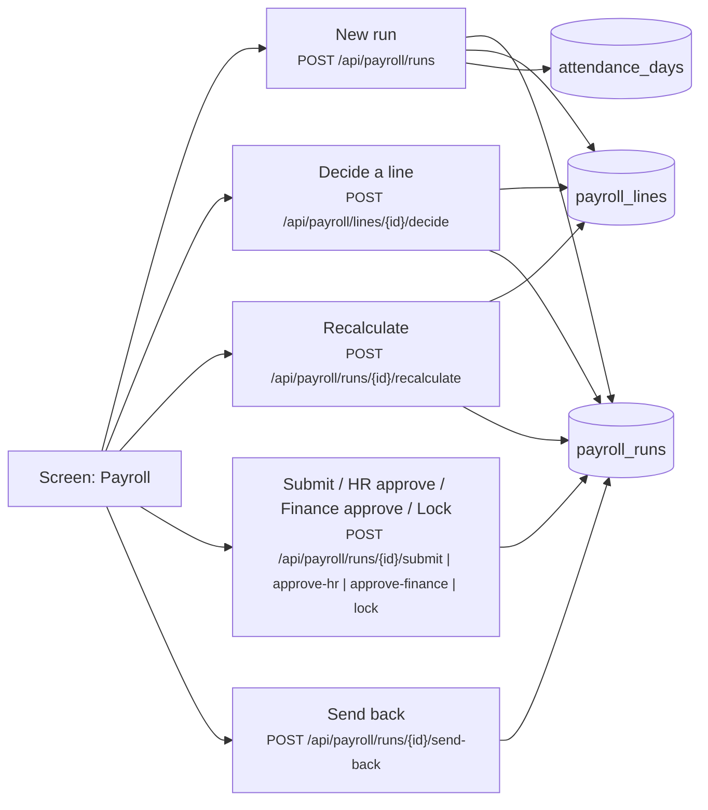

# Payroll run, checks and approvals

**Jira:** SCRUM-60, SCRUM-61, SCRUM-62, SCRUM-63, SCRUM-71, SCRUM-75  
**Status:** built (synthetic data on laptops). Items marked "not built" below are open.

## What it does

Deterministic calculation (not AI) per paying entity and month: locks attendance, applies inputs, calculates earnings, PF, ESI, PT, LWF, TDS and OT, then runs checks. Flagged lines need a decision (accept with note, or hold). Negative pay is blocked. Flow: calculated → reviewed → HR approved → Finance approved → locked; a locked run cannot change.

## Who uses it

| Role | Uses it to |
|---|---|
| Payroll preparer | Calculates, decides lines, submits |
| HR | Approves |
| Finance approver | Approves and locks |

## Screens

- Payroll (`/payroll`) → Runs
- Payroll run (`/payroll/runs/:id`)

## Use cases

## Data flow (screen → API → tables)

| Screen action | API | Reads | Writes |
|---|---|---|---|
| New run | `POST /api/payroll/runs` | employees, entity_allocations, salary_structures, attendance_days, monthly_inputs, statutory_rule_versions, policy_versions | payroll_runs, payroll_lines, attendance_days (locked), audit_log |
| Decide a line | `POST /api/payroll/lines/{id}/decide` | payroll_lines | payroll_lines, payroll_runs.totals, audit_log |
| Recalculate | `POST /api/payroll/runs/{id}/recalculate` | same as new run | payroll_lines, payroll_runs |
| Submit / HR approve / Finance approve / Lock | `POST /api/payroll/runs/{id}/submit \| approve-hr \| approve-finance \| lock` | payroll_runs | payroll_runs, audit_log |
| Send back | `POST /api/payroll/runs/{id}/send-back` | payroll_runs | payroll_runs, audit_log |

Diagram of the writes (every change also adds a row to `audit_log`, left out of the diagram for clarity):

## Rules and limits

- ON HOLD: no payroll changes until the client's salary sheets arrive.
- Blocked while missed punches are open and the missed-punch rule is unset.
- Same person cannot prepare and approve.

## Code and tests

- `services/hrms-core/backend/app/domain/payroll_engine.py`
- `services/hrms-core/backend/app/services/payroll.py`
- `services/hrms-core/backend/app/routers/payroll.py`
- Test: `test_payroll_engine.py`
- Test: `test_api_hv.py::test_attendance_and_payroll_flow`
- Test: `test_api_hv.py::test_preparer_cannot_approve`
