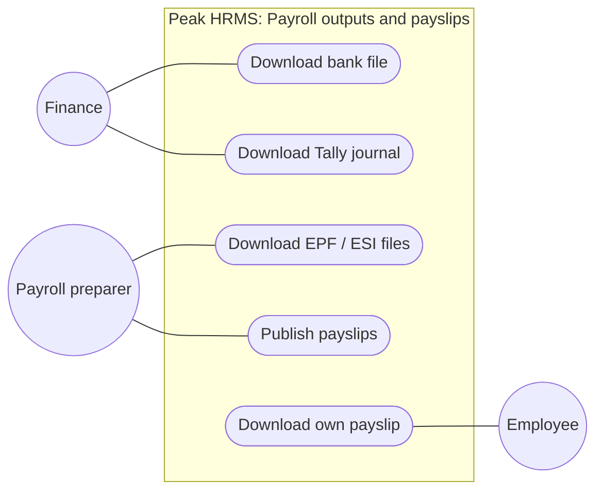
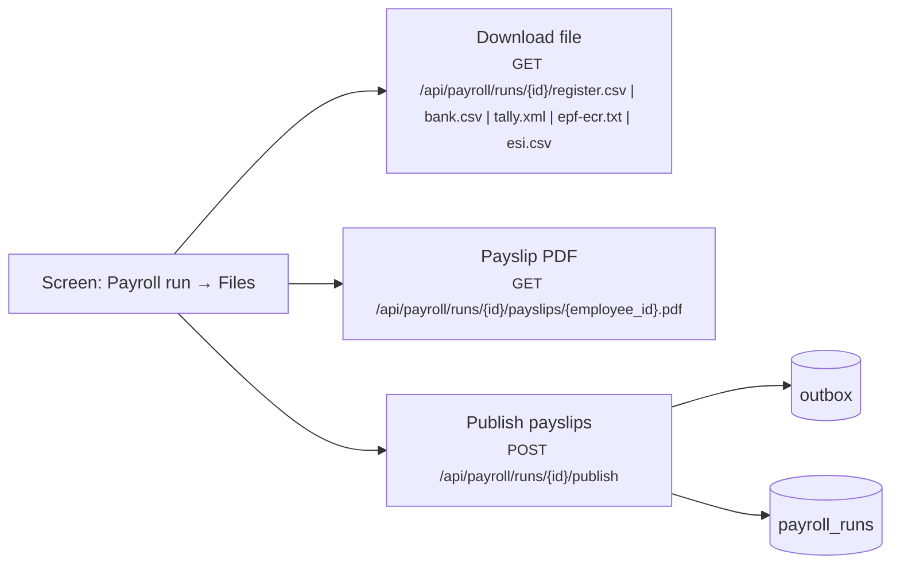

# Payroll outputs and payslips

**Jira:** SCRUM-64, SCRUM-72 (part), SCRUM-74 (part)  
**Status:** built (synthetic data on laptops). Items marked "not built" below are open.

## What it does

From a locked run only: payroll register, bank file (held lines left out), Tally journal XML, EPF ECR, ESI file and payslip PDFs (English, Tamil or Hindi labels). Publishing queues payslip messages in the outbox.

## Who uses it

| Role | Uses it to |
|---|---|
| Payroll preparer, Finance | Download files |
| Employee | Downloads own payslip |

## Screens

- Payroll run → Files
- My HR → Payslips

## Use cases

## Data flow (screen → API → tables)

| Screen action | API | Reads | Writes |
|---|---|---|---|
| Download file | `GET /api/payroll/runs/{id}/register.csv \| bank.csv \| tally.xml \| epf-ecr.txt \| esi.csv` | payroll_runs, payroll_lines, employees | — |
| Payslip PDF | `GET /api/payroll/runs/{id}/payslips/{employee_id}.pdf` | payroll_lines, employees | — |
| Publish payslips | `POST /api/payroll/runs/{id}/publish` | payroll_lines | outbox, payroll_runs, audit_log |

Diagram of the writes (every change also adds a row to `audit_log`, left out of the diagram for clarity):

## Rules and limits

- TDS return file is not built (SCRUM-72).
- WhatsApp sending is not live; messages stay in the outbox (SCRUM-73/74).

## Code and tests

- `services/hrms-core/backend/app/domain/outputs.py`
- `services/hrms-core/backend/app/routers/payroll.py`
- Test: `test_api_hv.py::test_attendance_and_payroll_flow`
