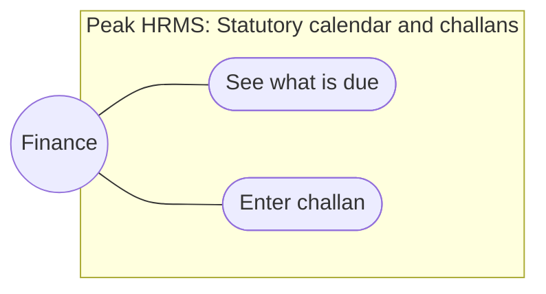
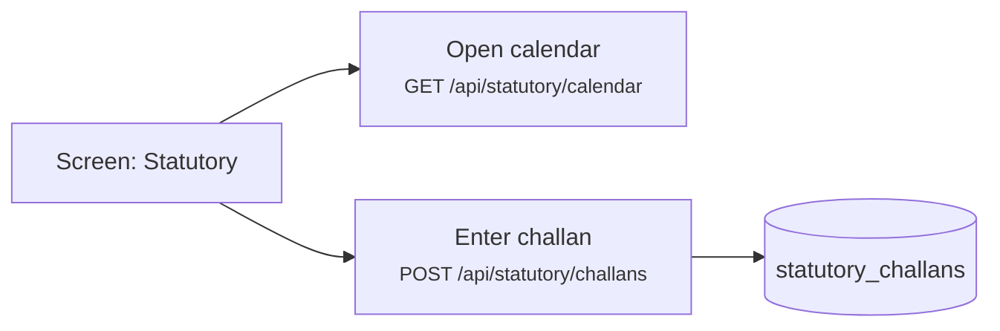

# Statutory calendar and challans

**Jira:** SCRUM-72 (part)  
**Status:** built (synthetic data on laptops). Items marked "not built" below are open.

## What it does

Due dates for EPF, ESI, PT, LWF and TDS per entity and period, built from locked payroll runs, with the amount due. Paid items get the challan number, date and amount.

## Who uses it

| Role | Uses it to |
|---|---|
| Payroll preparer, Finance, HR | Track and record payments |

## Screens

- Statutory (`/statutory`)

## Use cases

## Data flow (screen → API → tables)

| Screen action | API | Reads | Writes |
|---|---|---|---|
| Open calendar | `GET /api/statutory/calendar` | payroll_runs, payroll_lines, statutory_challans | — |
| Enter challan | `POST /api/statutory/challans` | — | statutory_challans, audit_log |

Diagram of the writes (every change also adds a row to `audit_log`, left out of the diagram for clarity):

## Rules and limits

- Status: due, overdue, paid.

## Code and tests

- `services/hrms-core/backend/app/routers/statutory_exits.py`
- Test: none yet
