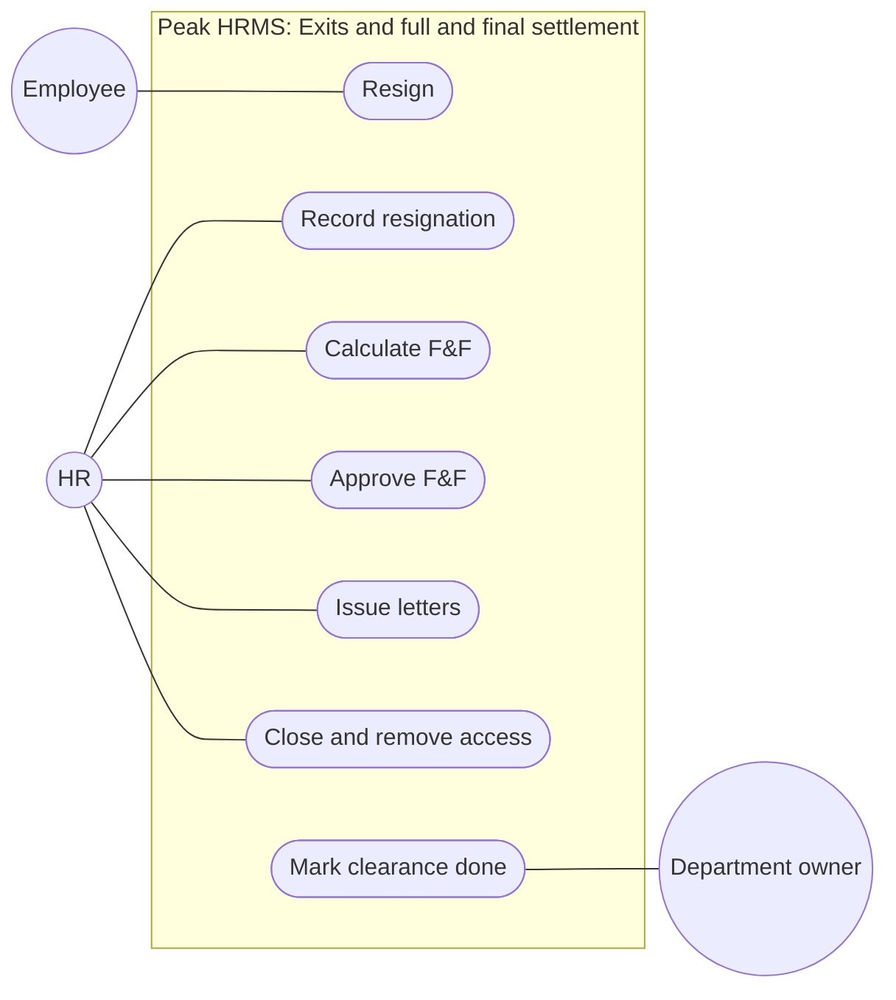
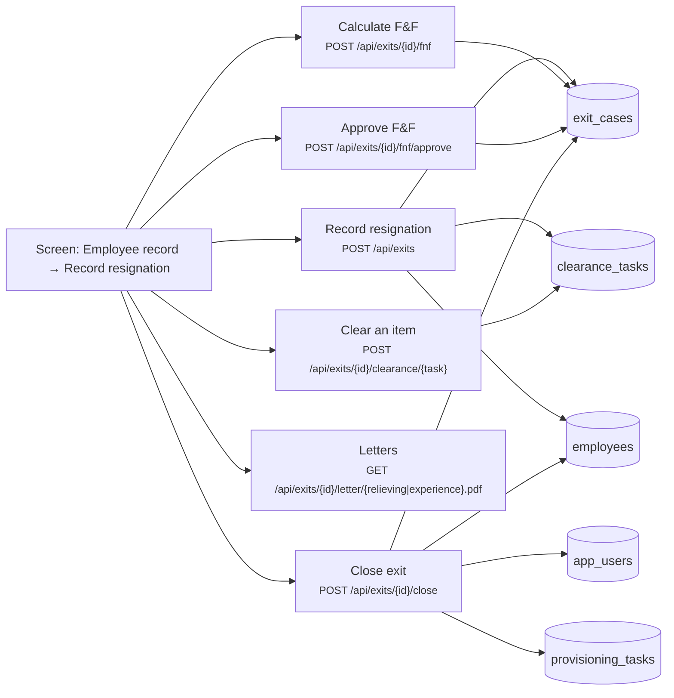

# Exits and full and final settlement

**Jira:** SCRUM-80, SCRUM-81  
**Status:** built (synthetic data on laptops). Items marked "not built" below are open.

## What it does

Resignation (by HR or by the employee in My HR) with last working day from the notice period, clearance tasks per department, F&F calculation (salary to last day, EL encashment, gratuity after 5 years, notice shortfall, loan and advance) due in 2 working days, relieving and experience letters, then closing the exit disables sign-in and biometric access.

## Who uses it

| Role | Uses it to |
|---|---|
| HR | Runs the exit |
| Employee | Resigns |
| Department owners | Clear items |

## Screens

- Employee record → Record resignation
- My HR → Resignation
- Exits & F&F (`/exits`, `/exits/:id`)

## Use cases

## Data flow (screen → API → tables)

| Screen action | API | Reads | Writes |
|---|---|---|---|
| Record resignation | `POST /api/exits` | employees, grades, policy_versions | exit_cases, clearance_tasks, employees.status, audit_log |
| Clear an item | `POST /api/exits/{id}/clearance/{task}` | clearance_tasks | clearance_tasks, audit_log |
| Calculate F&F | `POST /api/exits/{id}/fnf` | salary_structures, leave_balances, exit_cases | exit_cases.fnf, audit_log |
| Approve F&F | `POST /api/exits/{id}/fnf/approve` | exit_cases, clearance_tasks | exit_cases, audit_log |
| Letters | `GET /api/exits/{id}/letter/{relieving\|experience}.pdf` | exit_cases, employees | — |
| Close exit | `POST /api/exits/{id}/close` | exit_cases | exit_cases, employees, app_users, provisioning_tasks, audit_log |

Diagram of the writes (every change also adds a row to `audit_log`, left out of the diagram for clarity):

## Rules and limits

- F&F cannot be approved until clearance is complete.
- F&F due in fnf_days working days (Sunday and holidays excluded).

## Code and tests

- `services/hrms-core/backend/app/domain/fnf.py`
- `services/hrms-core/backend/app/routers/statutory_exits.py`
- Test: `test_attendance_imports_fnf.py`
- Test: `test_api_hv.py::test_exit_flow`
