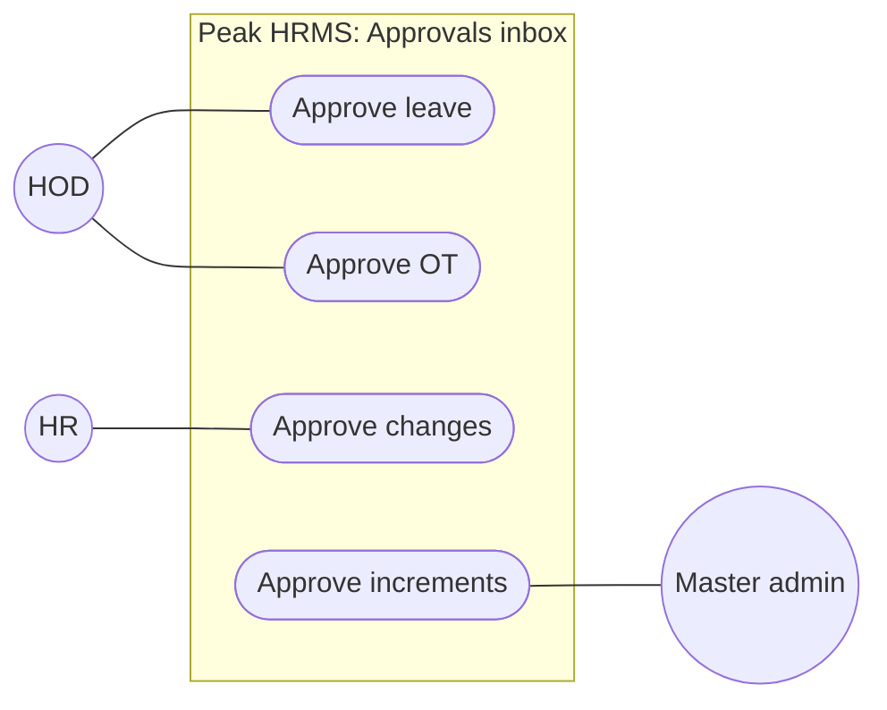
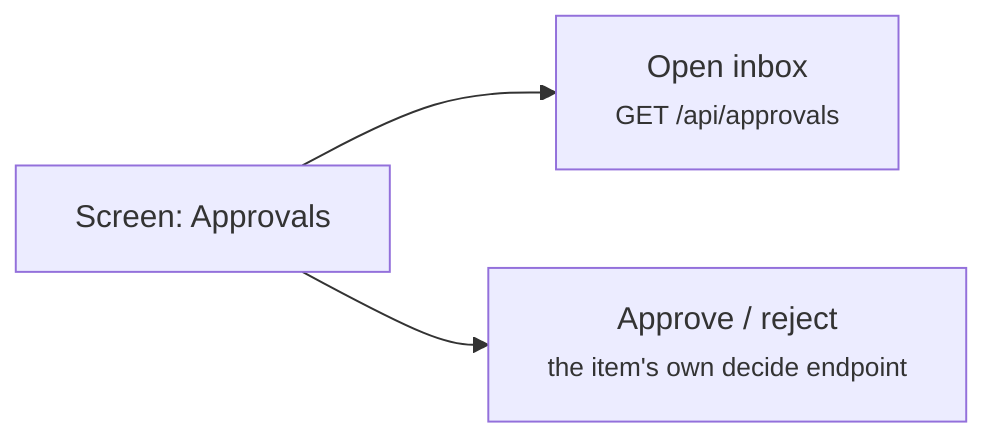

# Approvals inbox

**Jira:** SCRUM-82  
**Status:** built (synthetic data on laptops). Items marked "not built" below are open.

## What it does

One list of everything waiting for the signed-in person: leave, attendance fixes, OT, detail changes, F&F, payroll and increments, with approve and reject in place.

## Who uses it

| Role | Uses it to |
|---|---|
| HOD | Team leave, fixes, OT |
| HR | All of the above plus changes, F&F, payroll |
| Master admin | Increments (GM) |

## Screens

- Approvals (`/approvals`)

## Use cases

## Data flow (screen → API → tables)

| Screen action | API | Reads | Writes |
|---|---|---|---|
| Open inbox | `GET /api/approvals` | leave_requests, regularisations, attendance_days, change_requests, exit_cases, payroll_runs, increments | — |
| Approve / reject | `the item's own decide endpoint` | the item's table | the item's table, audit_log |

Diagram of the writes (every change also adds a row to `audit_log`, left out of the diagram for clarity):

## Rules and limits

- Payroll and F&F open their own page.

## Code and tests

- `services/hrms-core/backend/app/routers/people.py (approvals)`
- `services/hrms-core/frontend/src/pages/Approvals.jsx`
- Test: none yet
