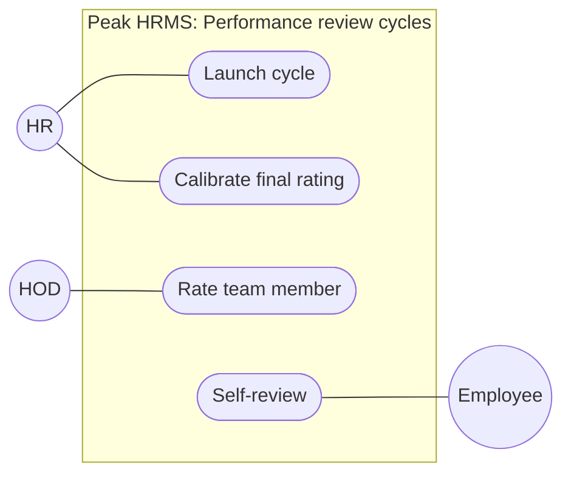
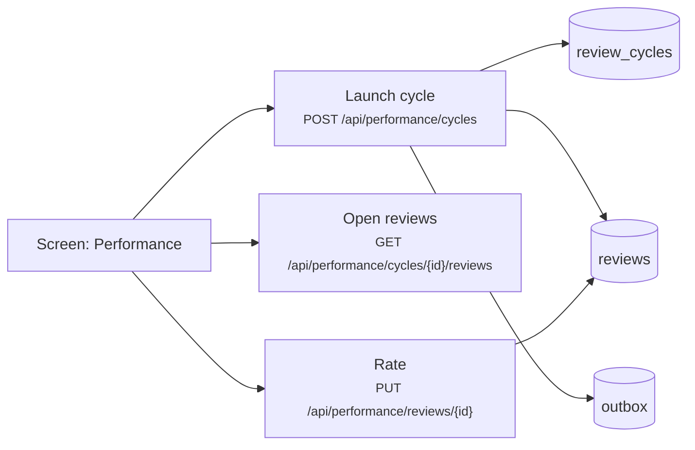

# Performance review cycles

**Jira:** SCRUM-85, SCRUM-86 (part)  
**Status:** built (synthetic data on laptops). Items marked "not built" below are open.

## What it does

HR launches a review cycle; each employee gets KRAs from the department template in the client package. Self ratings (API only), manager rating and comment, and HR's calibrated final rating.

## Who uses it

| Role | Uses it to |
|---|---|
| HR | Launches and calibrates |
| HOD | Rates team |
| Employee | Self-review (API only for now) |

## Screens

- Performance (`/performance`) → Reviews

## Use cases

## Data flow (screen → API → tables)

| Screen action | API | Reads | Writes |
|---|---|---|---|
| Launch cycle | `POST /api/performance/cycles` | employees | review_cycles, reviews, outbox, audit_log |
| Open reviews | `GET /api/performance/cycles/{id}/reviews` | reviews, employees | — |
| Rate | `PUT /api/performance/reviews/{id}` | reviews | reviews, audit_log |

Diagram of the writes (every change also adds a row to `audit_log`, left out of the diagram for clarity):

## Rules and limits

- Hotel Vivek KRA templates: services/hotel_vivek_backend/hotel_vivek/tenant.py (KRA_TEMPLATES).
- No screen yet for staff self-review; no drafted comment (SCRUM-86).

## Code and tests

- `services/hrms-core/backend/app/routers/people.py`
- Test: none yet
