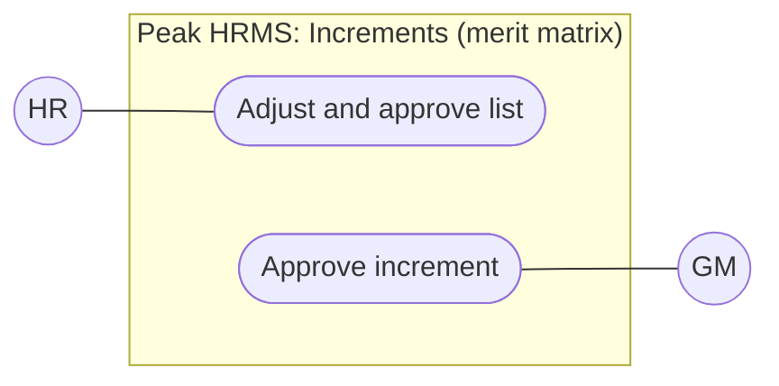
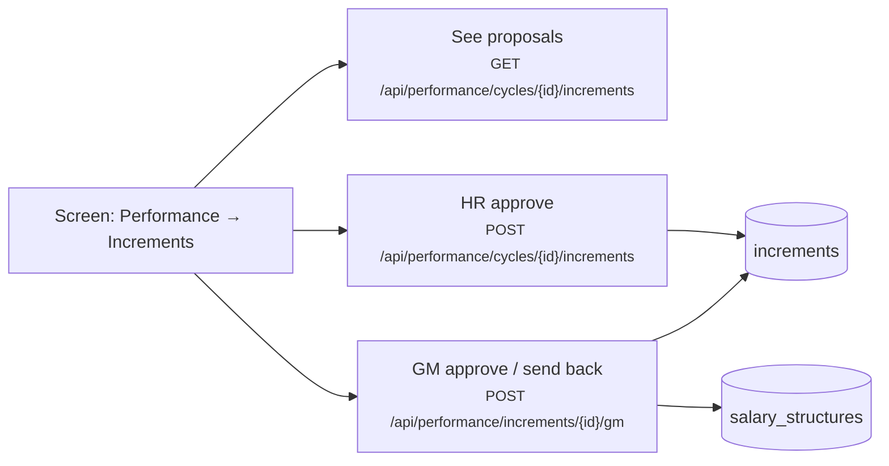

# Increments (merit matrix)

**Jira:** SCRUM-87  
**Status:** built (synthetic data on laptops). Items marked "not built" below are open.

## What it does

Suggested increment % from final rating × position in the grade's pay band. HR approves the list; the GM (master admin) approves each, which creates a new dated salary structure that payroll uses from the effective date.

## Who uses it

| Role | Uses it to |
|---|---|
| HR | Proposes |
| Master admin (GM) | Approves |

## Screens

- Performance → Increments
- Approvals

## Use cases

## Data flow (screen → API → tables)

| Screen action | API | Reads | Writes |
|---|---|---|---|
| See proposals | `GET /api/performance/cycles/{id}/increments` | reviews, salary_structures, grades | — |
| HR approve | `POST /api/performance/cycles/{id}/increments` | — | increments, audit_log |
| GM approve / send back | `POST /api/performance/increments/{id}/gm` | increments | increments, salary_structures, audit_log |

Diagram of the writes (every change also adds a row to `audit_log`, left out of the diagram for clarity):

## Rules and limits

- Merit matrix is a sample (people.py MERIT).

## Code and tests

- `services/hrms-core/backend/app/routers/people.py`
- Test: none yet
