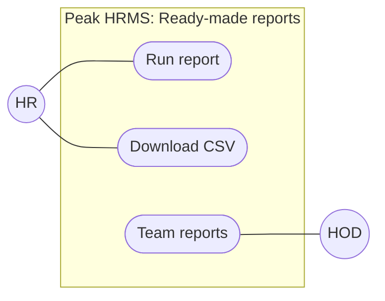
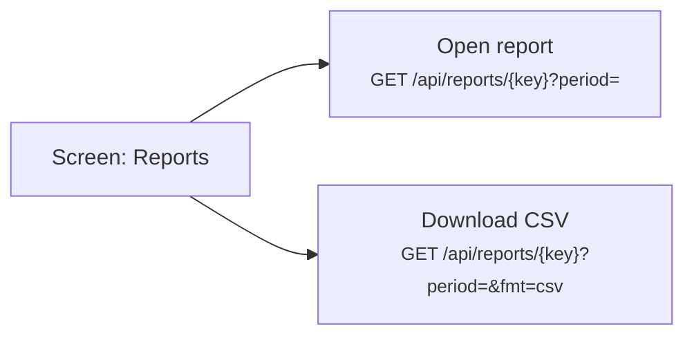

# Ready-made reports

**Jira:** SCRUM-88 (part)  
**Status:** built (synthetic data on laptops). Items marked "not built" below are open.

## What it does

Eight reports limited to the staff the user may see: headcount, joiners and leavers, month attendance, OT by department, payroll register, leave balances, documents expiring, birthdays. On screen or as CSV.

## Who uses it

| Role | Uses it to |
|---|---|
| Master admin, HR, Payroll, Finance, HOD | Read |

## Screens

- Reports (`/reports`)

## Use cases

## Data flow (screen → API → tables)

| Screen action | API | Reads | Writes |
|---|---|---|---|
| Open report | `GET /api/reports/{key}?period=` | employees, attendance_days, payroll_lines, leave_balances, employee_documents | — |
| Download CSV | `GET /api/reports/{key}?period=&fmt=csv` | same | — |

Diagram of the writes (every change also adds a row to `audit_log`, left out of the diagram for clarity):

## Rules and limits

- Plain-language questions and scheduling are not built (SCRUM-88).

## Code and tests

- `services/hrms-core/backend/app/routers/people.py (reports)`
- Test: `test_api_hv.py::test_reports_dashboard_circular`
