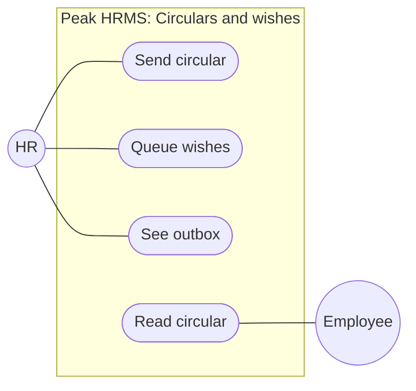
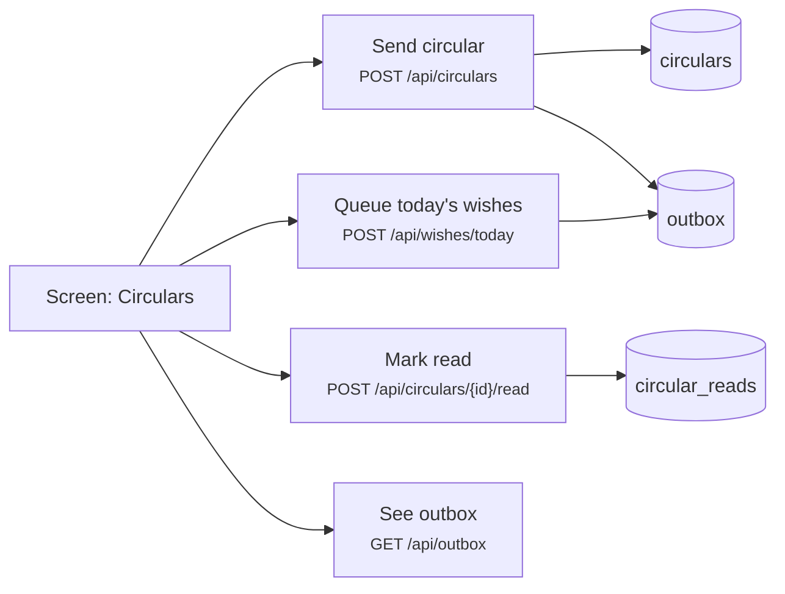

# Circulars and wishes

**Jira:** SCRUM-90 (part)  
**Status:** built (synthetic data on laptops). Items marked "not built" below are open.

## What it does

HR writes a circular in English plus the client's other languages, for all staff or chosen locations and departments. Each employee gets their own language. Read tracking per circular. Birthday and work-anniversary wishes are queued daily.

## Who uses it

| Role | Uses it to |
|---|---|
| HR, Master admin | Send circulars |
| Employees | Receive |

## Screens

- Circulars (`/circulars`) → Circulars, Outbox

## Use cases

## Data flow (screen → API → tables)

| Screen action | API | Reads | Writes |
|---|---|---|---|
| Send circular | `POST /api/circulars` | employees | circulars, outbox, audit_log |
| Mark read | `POST /api/circulars/{id}/read` | circulars | circular_reads |
| Queue today's wishes | `POST /api/wishes/today` | employees | outbox |
| See outbox | `GET /api/outbox` | outbox | — |

Diagram of the writes (every change also adds a row to `audit_log`, left out of the diagram for clarity):

## Rules and limits

- No automatic translation; translations are typed and checked by a native speaker.
- WhatsApp sending is not live (outbox only).

## Code and tests

- `services/hrms-core/backend/app/routers/people.py`
- `services/hrms-core/frontend/src/pages/Comms.jsx`
- Test: `test_api_hv.py::test_reports_dashboard_circular`
