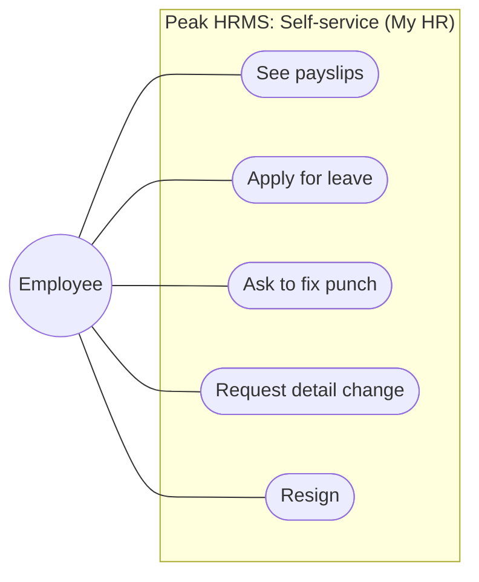
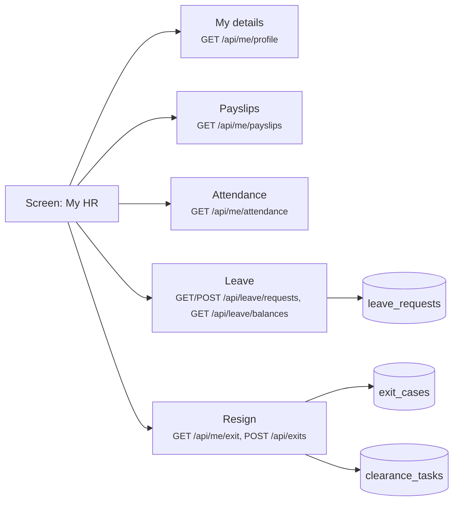

# Self-service (My HR)

**Jira:** SCRUM-91 (part), SCRUM-80  
**Status:** built (synthetic data on laptops). Items marked "not built" below are open.

## What it does

Staff see their details, request changes, download payslips, see attendance and ask to fix punches, apply for and cancel leave, and resign.

## Who uses it

| Role | Uses it to |
|---|---|
| Employee (any user linked to an employee) | Uses My HR |

## Screens

- My HR (`/me`) → My details, Payslips, Attendance, Leave, Resignation

## Use cases

## Data flow (screen → API → tables)

| Screen action | API | Reads | Writes |
|---|---|---|---|
| My details | `GET /api/me/profile` | employees, change_requests | — |
| Payslips | `GET /api/me/payslips` | payroll_lines, payroll_runs | — |
| Attendance | `GET /api/me/attendance` | attendance_days | — |
| Leave | `GET/POST /api/leave/requests, GET /api/leave/balances` | leave_balances | leave_requests |
| Resign | `GET /api/me/exit, POST /api/exits` | exit_cases | exit_cases, clearance_tasks |

Diagram of the writes (every change also adds a row to `audit_log`, left out of the diagram for clarity):

## Rules and limits

- 'Ask HR' and WhatsApp self-service are not built; questions will go to the Brain through the Ask Brain link after the demo (SCRUM-131).

## Code and tests

- `services/hrms-core/backend/app/routers/people.py (/me)`
- `services/hrms-core/frontend/src/pages/Me.jsx`
- Test: `test_api_hv.py::test_scope_and_masking`
