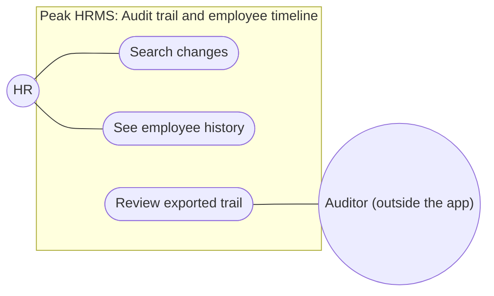
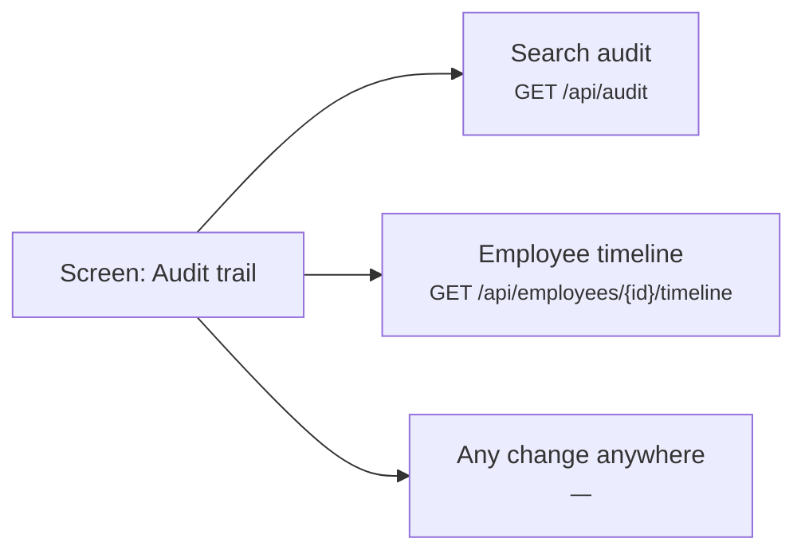

# Audit trail and employee timeline

**Jira:** SCRUM-47, SCRUM-92  
**Status:** built (synthetic data on laptops). Items marked "not built" below are open.

## What it does

Every change is written to an append-only audit log (who, when, what, before and after, sensitive values masked). A database trigger rejects UPDATE and DELETE on Postgres. The employee timeline shows dated assignments and that person's audit events.

## Who uses it

| Role | Uses it to |
|---|---|
| Master admin, HR | Read |

## Screens

- Audit trail (`/audit`)
- Employee record → Timeline

## Use cases

## Data flow (screen → API → tables)

| Screen action | API | Reads | Writes |
|---|---|---|---|
| Search audit | `GET /api/audit` | audit_log | — |
| Employee timeline | `GET /api/employees/{id}/timeline` | assignments, audit_log | — |
| Any change anywhere | `—` | — | audit_log (insert only) |

Diagram of the writes (every change also adds a row to `audit_log`, left out of the diagram for clarity):

## Rules and limits

- CI proves the trigger blocks UPDATE (decision 0002).

## Code and tests

- `services/hrms-core/backend/app/services/audit.py`
- `services/hrms-core/backend/alembic/versions/0001_baseline.py`
- Test: `test_api_hv.py::test_audit_and_timeline`
