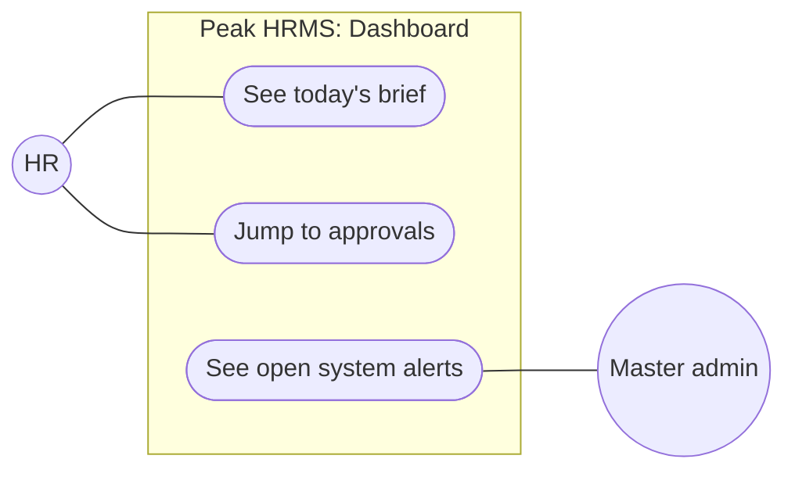
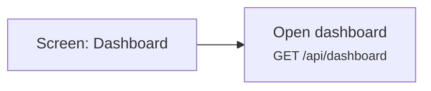

# Dashboard

**Jira:** SCRUM-89 (part)  
**Status:** built (synthetic data on laptops). Items marked "not built" below are open.

## What it does

Today's brief (missed punches, approvals waiting, open system alerts), headcount, present today, approvals and documents expiring, headcount by location, recent payroll runs and open exits. Staff without HR rights see a short home with links to My HR.

## Who uses it

| Role | Uses it to |
|---|---|
| Master admin, HR, Payroll, Finance, HOD | Daily overview |
| Employee | Shortcuts |

## Screens

- Dashboard (`/`)

## Use cases

## Data flow (screen → API → tables)

| Screen action | API | Reads | Writes |
|---|---|---|---|
| Open dashboard | `GET /api/dashboard` | employees, attendance_days, leave_requests, regularisations, change_requests, employee_documents, payroll_runs, exit_cases, policy_versions, monitor_alerts | — |

Diagram of the writes (every change also adds a row to `audit_log`, left out of the diagram for clarity):

## Rules and limits

- Scheduled morning brief and phone layout for the GM (SCRUM-89) are not built.

## Code and tests

- `services/hrms-core/backend/app/routers/core.py (dashboard)`
- `services/hrms-core/frontend/src/pages/Dashboard.jsx`
- Test: `test_api_hv.py::test_reports_dashboard_circular`
- Test: `test_monitoring.py`
