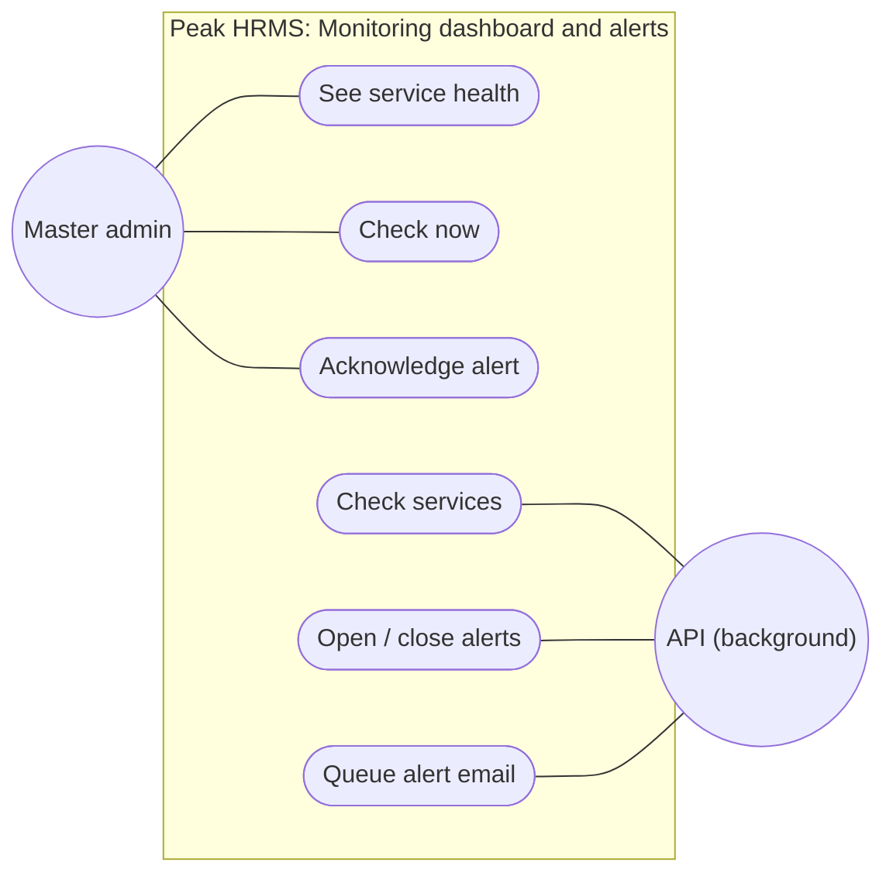
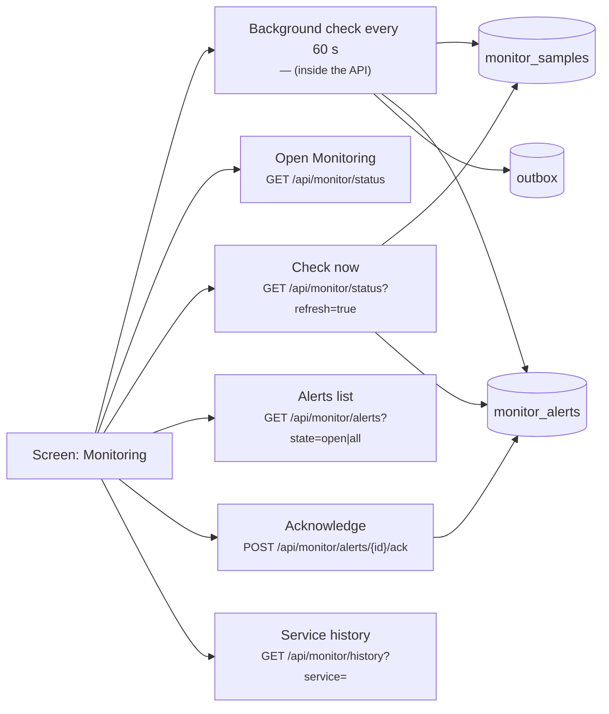

# Monitoring dashboard and alerts

**Jira:** SCRUM-130  
**Status:** built (synthetic data on laptops). Items marked "not built" below are open.

## What it does

Health of the 5 core services — web app, API, database, sign-in (Cognito) and biometric feed — checked every 60 seconds by the API, with response time, 24-hour uptime, recent history and key numbers. Alerts open automatically (down twice = critical, degraded three times = warning), close when the service recovers, can be acknowledged, and are queued as emails if MONITOR_ALERT_EMAILS is set.

## Who uses it

| Role | Uses it to |
|---|---|
| Master admin | Watches services and acknowledges alerts |

## Screens

- Monitoring (`/monitor`)
- Dashboard → today's brief ('system alerts open')

## Use cases

## Data flow (screen → API → tables)

| Screen action | API | Reads | Writes |
|---|---|---|---|
| Background check every 60 s | `— (inside the API)` | employees, app_users, provisioning_tasks, punches | monitor_samples, monitor_alerts, outbox |
| Open Monitoring | `GET /api/monitor/status` | monitor_samples, monitor_alerts | — (or monitor_samples when nothing checked yet) |
| Check now | `GET /api/monitor/status?refresh=true` | same | monitor_samples, monitor_alerts |
| Alerts list | `GET /api/monitor/alerts?state=open\|all` | monitor_alerts | — |
| Acknowledge | `POST /api/monitor/alerts/{id}/ack` | monitor_alerts | monitor_alerts, audit_log |
| Service history | `GET /api/monitor/history?service=` | monitor_samples | — |

Diagram of the writes (every change also adds a row to `audit_log`, left out of the diagram for clarity):

## Rules and limits

- If the API itself is down nothing inside it can alert: the container health check and infrastructure monitoring (SCRUM-132) cover that.
- Samples are kept MONITOR_KEEP_DAYS days (7).
- Biometric is 'degraded' when no new punches for MONITOR_BIOMETRIC_STALE_HOURS (26).

## Code and tests

- `services/hrms-core/backend/app/services/monitoring.py`
- `services/hrms-core/backend/app/routers/monitoring.py`
- `services/hrms-core/frontend/src/pages/Monitor.jsx`
- Test: `tests/test_monitoring.py`
